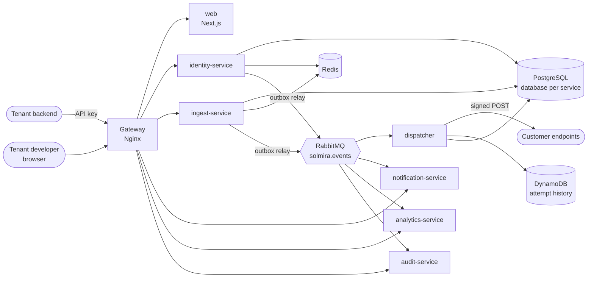
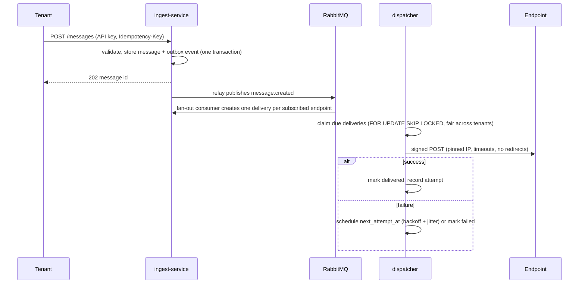
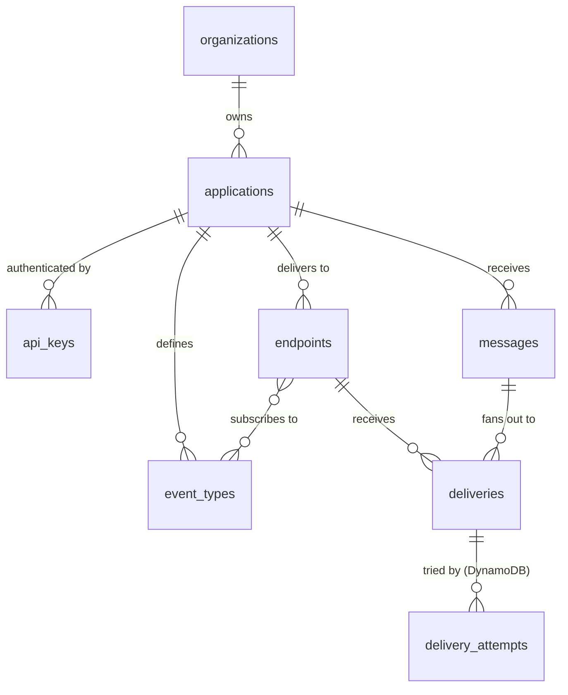

# Solmira Architecture

This is the living architecture document for Solmira, a multi-tenant webhook delivery platform.
It describes the target design and marks what exists. Deeper material lives in
[`docs/architecture/`](docs/architecture/) and decisions are recorded as ADRs in
[`docs/adr/`](docs/adr/). The pivot is [ADR-0023](docs/adr/0023-pivot-to-webhook-delivery.md).

> Status legend: **Built** = implemented and tested, **Planned (Phase N)** = designed, lands in the phase noted.

## 1. System context



Built: gateway, web (authentication and organization pages), identity-service, ingest-service
(management API, ingestion, fan-out, replay, rotation), the dispatcher with endpoint isolation and its
DynamoDB attempt history, and notification-service (alerts). Planned: the console (Phase 8), the
realtime feed and analytics (Phase 9) and the audit consumer (Phase 10).

## 2. Repository structure

```
apps/
  web/                    Next.js 16 app router UI (console)
  identity-service/       auth, sessions, organizations, members, roles, invitations
  ingest-service/         applications, API keys, event types, endpoints, message ingestion, fan-out
  dispatcher/             delivery worker: claims, signs, sends, retries
  notification-service/   tenant alerts about failing endpoints
  analytics-service/      delivery success rate and latency read models
  audit-service/          audit log of administrative actions
packages/
  contracts/              zod schemas + types shared by web and services (HTTP, events, permissions)
  service-kit/            NestJS platform module: config, logging, request context, errors,
                          health, Postgres/Redis/RabbitMQ clients, bootstrap, DB helpers
infra/
  docker/                 Dockerfiles, Nginx gateway config, Postgres init scripts
  terraform/              AWS infrastructure (Planned, Phase 12)
docs/
  architecture/  adr/  api/  phases/
```

Tooling: pnpm workspaces + Turborepo, TypeScript 6 strict, ESM everywhere (NestJS 12 is ESM-only),
ESLint flat config, Prettier, Vitest, knip for dead code.

## 3. Service boundaries

Services are cut along **consistency boundaries**: data that must change atomically lives in one
service and one database; everything else communicates through events
([ADR-0024](docs/adr/0024-service-boundaries-webhook-platform.md)).

| Service                  | Owns                                                                                          | Why it is separate                                                                  |
| ------------------------ | --------------------------------------------------------------------------------------------- | ----------------------------------------------------------------------------------- |
| **identity-service**     | users, credentials, sessions, organizations, memberships, roles, permissions, invitations     | Security-critical, holds the token signing key.                                     |
| **ingest-service**       | applications, API keys, event types, endpoints, signing secrets, messages, deliveries, outbox | A message, its outbox event and its fan-out must commit together.                   |
| **dispatcher**           | nothing durable of its own; reads and updates delivery state, writes attempt history          | Long-running outbound traffic to untrusted hosts must scale and fail independently. |
| **notification-service** | tenant alerts                                                                                 | Pure event consumer; its failure must never block delivery.                         |
| **analytics-service**    | pre-aggregated delivery statistics                                                            | Expensive reads must not share a database with the delivery path.                   |
| **audit-service**        | audit log                                                                                     | Append-only, long retention.                                                        |

## 4. Core flow (built end to end)



Delivery state and `next_attempt_at` live in PostgreSQL and are claimed with
`FOR UPDATE SKIP LOCKED`, at most a few per organization per pass so one tenant's backlog cannot
fill a batch ([ADR-0031](docs/adr/0031-dispatcher-design.md)). RabbitMQ carries fan-out;
"DLQ" is an explicit `failed` state plus replay. Isolation is decided at claim time: saturated endpoints and
endpoints with an open circuit are not claimed, a breaker per endpoint trips after repeated failures,
and a long failure streak disables the endpoint and notifies its owner once
([ADR-0033](docs/adr/0033-isolation-failure-handling-replay.md)). A claim carries a lease, so work
held by a dead worker is retried. Each HTTP attempt is recorded in DynamoDB
([ADR-0032](docs/adr/0032-attempt-history-dynamodb.md)); PostgreSQL holds the current state.

Delivery is **at least once**. A worker that dies after sending and before recording retries the
delivery with the same `webhook-id`; receivers deduplicate on it.

## 5. Request path

Status: **Built** in identity-service. ingest-service uses the same `AuthModule` and tenant-scoped
database helper from `service-kit`.

1. **Gateway (Nginx)** assigns or propagates `X-Request-Id` and `X-Correlation-Id`, applies edge rate
   limits and security headers, routes by path prefix, and writes JSON access logs. It holds no business logic.
2. **Service** runs the request-context middleware (AsyncLocalStorage) so every log line and
   emitted event carries both IDs. One global `AuthGuard` verifies the access token locally
   (Ed25519-signed JWT; public key from configuration, also published as JWKS by identity-service),
   checks the Redis revocation denylist, and checks the required permission for the tenant resolved
   _from the token_. The organization ID is never taken from the request body or query; a route
   `:organizationId` must equal the token's organization, otherwise the answer is 404.
3. **Data access** runs inside a tenant-scoped transaction (`inTenantScope`). Queries filter by
   `organization_id`, and PostgreSQL Row Level Security enforces the same rule as defense in depth.

Ingestion with an API key is a second authentication scheme next to the JWT guard (keys and the
database lookup built in Phase 4, the HTTP guard and per-key rate limit in Phase 5): the key's hash is looked up in ingest-service's own database, which resolves the
organization and application.

Routing table (gateway → service):

| Prefix                                                                                      | Service              |
| ------------------------------------------------------------------------------------------- | -------------------- |
| `/api/v1/auth`, `/me`, `/organizations`, `/users`, `/roles`, `/permissions`, `/invitations` | identity-service     |
| `/api/v1/applications` (with `/endpoints`, `/api-keys`), `/event-types`                     | ingest-service       |
| `/api/v1/notifications`, `/ws`                                                              | notification-service |
| `/api/v1/analytics`, `/graphql`                                                             | analytics-service    |
| `/api/v1/audit-logs`                                                                        | audit-service        |
| everything else                                                                             | web                  |

The browser talks only to the gateway origin, so there is no CORS surface in production.

## 6. Multi-tenancy

Strategy: **shared database, shared schema, `organization_id` on every tenant-owned row**
([ADR-0006](docs/adr/0006-multi-tenancy-shared-schema.md), [ADR-0012](docs/adr/0012-postgresql-row-level-security.md)).
Status: **Built** for identity-service and for the ingest-service resource tables (Phase 4). Full description: [`docs/architecture/tenant-isolation.md`](docs/architecture/tenant-isolation.md).

Three layers of enforcement:

1. **Application**: tenant ID comes only from the verified token (or the API key's own record);
   repositories require it as an argument.
2. **Schema**: composite foreign keys `(organization_id, id)` make it impossible to _reference_
   another tenant's row even with a guessed UUID.
3. **Database**: RLS policies `USING (organization_id = app_current_organization_id())`, where the
   function reads `current_setting('app.organization_id', true)` and yields `NULL` (no rows) when
   the setting is missing. The service connects as a non-owner role and sets the setting with
   `set_config(..., true)` at the start of every transaction. RLS is enabled, not forced; readiness
   fails if the runtime role could bypass it.

Lookups by ID for an entity in another tenant return **404, not 403**.

DynamoDB has no RLS. Attempt history will isolate tenants with a `TENANT#<orgId>` key prefix,
IAM leading-keys conditions in AWS, and application-level cross-tenant tests (ADR with Phase 6).

## 7. Identity

Status: **Built**. identity-service issues Ed25519-signed access tokens (15 min, held in browser
memory only) and rotates opaque refresh tokens held in an `httpOnly`, `SameSite=Strict` cookie
scoped to `/api/v1/auth`; reusing a consumed refresh token revokes the whole session. Access is
checked by permission from a catalog in `@solmira/contracts`, synced to the database on deploy
(removed permissions are pruned), and role changes take effect immediately through a Redis denylist.

- [`docs/architecture/authentication.md`](docs/architecture/authentication.md)
- [`docs/architecture/authorization.md`](docs/architecture/authorization.md)
- [`docs/architecture/tenant-isolation.md`](docs/architecture/tenant-isolation.md)
- ADRs [0010](docs/adr/0010-authentication-strategy.md), [0011](docs/adr/0011-refresh-token-rotation.md), [0012](docs/adr/0012-postgresql-row-level-security.md); overview in [`SECURITY.md`](SECURITY.md)

## 8. Domain model (Phase 4 built; messages and deliveries Planned)



| Concept          | Meaning                                                                                                |
| ---------------- | ------------------------------------------------------------------------------------------------------ |
| Application      | A tenant's app or environment (production, staging).                                                   |
| API key          | Per application; hashed at rest, shown once, scoped, revocable, with last-used tracking.               |
| Event type       | e.g. `invoice.paid`; optional JSON Schema for the payload; can be archived.                            |
| Endpoint         | A destination URL: subscribed event types, signing secrets, enabled state, rate limit, custom headers. |
| Message          | One event sent by the tenant: event type, payload, idempotency key, timestamp.                         |
| Delivery         | The state of one message to one endpoint (PostgreSQL).                                                 |
| Delivery attempt | One HTTP attempt: status, latency, truncated response, error class, next retry (DynamoDB with TTL).    |

Conventions: UUIDv7 primary keys generated in the application, `timestamptz` in UTC, `created_at` /
`updated_at` on mutable tables.

**identity DB** (built): `users`, `organizations`, `organization_members`, `roles`, `permissions`,
`role_permissions`, `invitations`, `sessions`, `refresh_tokens`, `email_tokens`, `outbox_events`.
Tokens are stored only as SHA-256 hashes.

**ingest DB** (built, Phase 4): `applications`, `event_types` (shared by all applications of an
organization), `endpoints`, `endpoint_event_types`, `endpoint_secrets` (envelope-encrypted),
`api_keys` (digests only), `outbox_events`, the `app_current_organization_id()` function and the
`authenticate_api_key()` lookup. Every tenant table has RLS and composite tenant keys. Phase 5 added `messages`,
`idempotency_keys`, `deliveries` and `processed_events`; the dispatcher (Phase 6) works on `deliveries`.

## 9. Security design for outbound delivery (built)

- **Signing:** [Standard Webhooks](https://www.standardwebhooks.com/): `webhook-id`,
  `webhook-timestamp`, `webhook-signature` (HMAC-SHA256). During a rotation window both the old and
  the new secret sign the request.
- **SSRF:** endpoint URLs and redirect targets that resolve to private, loopback, link-local
  (including 169.254.169.254), multicast or reserved ranges are rejected for IPv4 and IPv6. DNS is
  resolved at send time, inside the connection's own lookup, and the socket connects to exactly that
  validated address, so DNS rebinding has no window. HTTPS only in production. Redirects are not followed.
- **Secrets:** signing secrets are stored with envelope encryption (a local key in development,
  AWS KMS in production), never logged and never returned after creation, except through an
  explicit, audited "reveal" permission. API keys are stored as hashes.
- **Limits:** connect and total timeouts, maximum payload size, maximum stored response size,
  per-endpoint rate limiting in Redis, fair claiming across tenants.

See [`SECURITY.md`](SECURITY.md) for the threat model.

## 10. Event model

All integration events share one envelope (defined in `packages/contracts`):

```ts
{
  eventId: string; // UUIDv7, used for idempotency
  type: string; // e.g. "message.created"
  version: number; // payload schema version
  occurredAt: string; // ISO-8601 UTC
  organizationId: string | null;
  actorId: string | null;
  correlationId: string; // ties the event to the originating request
  causationId: string | null; // eventId that caused this one
  payload: unknown;
}
```

Topology (Built, Phase 5, ADR-0029): one durable **topic exchange** `solmira.events`, routing key = event
type. Each consuming service owns a queue (`<service>.events`) bound to the patterns it cares
about, a retry queue (`<queue>.retry`, fixed TTL) and a DLQ (`<queue>.dlq`) after N attempts.

Delivery is **at least once**. Producers write events into `outbox_events` inside the business
transaction (Built for identity and ingest). The ingest-service relay publishes them with publisher
confirms, claiming batches with `FOR UPDATE SKIP LOCKED`. Consumers are idempotent: they insert
`(consumer, event_id)` into `processed_events` in the same transaction as their side effect (the
fan-out consumer in ingest-service does exactly this).

## 11. Cross-cutting

- **Config**: every service validates `process.env` with zod at startup and fails fast with the
  names (never the values) of invalid variables.
- **Logging**: pino JSON logs; every line has `service`, `requestId`, `correlationId`.
  Authorization headers, cookies, passwords, tokens, secrets and API keys are redacted at the logger.
- **Errors**: one envelope `{ error: { code, message, details?, requestId } }`. Unknown errors become
  `500 INTERNAL_ERROR` with no stack or driver message leaked to clients.
- **Health**: `GET /health/live` and `GET /health/ready` (dependencies reachable, each check time-boxed).
- **Idempotency**: the `Idempotency-Key` header contract lives in `@solmira/contracts`; the ingestion
  API honors it per (application, key) for 24 hours by default (Planned, Phase 5).
- **Observability** (Planned, Phase 12): structured logs, Prometheus-format metrics, OpenTelemetry
  traces across HTTP and RabbitMQ, dashboards and alerts as code.

## 12. Deployment (Planned, Phase 12)

CloudFront → ALB → ECS Fargate services in private subnets, RDS PostgreSQL (Multi-AZ), ElastiCache
Redis, Amazon MQ for RabbitMQ, DynamoDB, KMS for secret encryption, Secrets Manager for credentials,
CloudWatch for logs and metrics, all defined in Terraform. Nothing is applied without the owner's approval.
