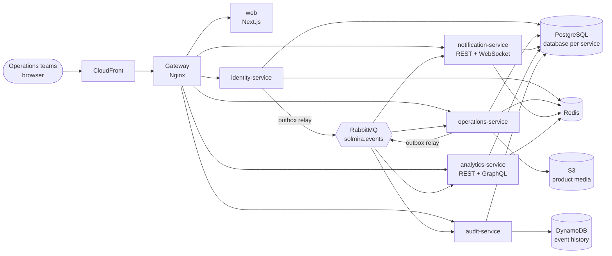
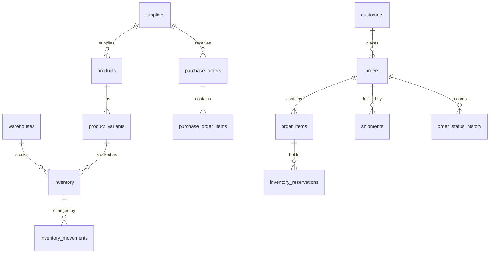

# Solmira Architecture

This is the living architecture document for Solmira. It starts as the design proposal
written before implementation and is updated as each phase lands. Deeper material lives in
[`docs/architecture/`](docs/architecture/) and decisions are recorded as ADRs in
[`docs/adr/`](docs/adr/).

> Status legend: **Built** = implemented and tested, **Planned** = designed, lands in the phase noted.

## 1. System context



## 2. Repository structure

```
apps/
  web/                    Next.js 16 app router UI (operations console)
  identity-service/       auth, sessions, organizations, members, roles, invitations
  operations-service/     catalog, suppliers, warehouses, inventory, purchasing, orders, fulfillment
  notification-service/   in-app + email notifications, preferences, WebSocket gateway
  analytics-service/      event-fed read models, dashboard REST + GraphQL
  audit-service/          audit log query API, event-history archive (DynamoDB)
packages/
  contracts/              zod schemas + types shared by web and services (HTTP, events, permissions)
  service-kit/            NestJS platform module: config, logging, request context, errors,
                          health, Postgres/Redis/RabbitMQ clients, bootstrap
infra/
  docker/                 Dockerfiles, Nginx gateway config, Postgres init scripts
  terraform/              AWS infrastructure (phase 12)
docs/
  architecture/  adr/  runbooks/
```

Tooling: pnpm workspaces + Turborepo (task graph and caching), TypeScript 6 strict everywhere,
ESM everywhere (NestJS 12 is ESM-only), ESLint flat config, Prettier, Vitest.

## 3. Service boundaries

Services are cut along **consistency boundaries**, not along nouns. The rule: data that must change
atomically together lives in one service and one database. Everything else talks through events.

| Service                  | Owns                                                                                            | Why it is separate                                                                                                                                                |
| ------------------------ | ----------------------------------------------------------------------------------------------- | ----------------------------------------------------------------------------------------------------------------------------------------------------------------- |
| **identity-service**     | users, credentials, sessions, organizations, memberships, roles, permissions, invitations       | Security-critical, different change cadence, the only holder of the token signing key.                                                                            |
| **operations-service**   | products, variants, suppliers, customers, warehouses, inventory, POs, orders, shipments         | Order confirmation, inventory reservation and receiving must be ACID. Splitting orders from inventory would turn the most correctness-sensitive path into a saga. |
| **notification-service** | notifications, preferences, delivery attempts, WebSocket connections                            | Pure event consumer; scales with connected clients, not with orders. Failure must never block an order.                                                           |
| **analytics-service**    | pre-aggregated read models (daily sales, product sales, inventory value, fulfillment durations) | Expensive reads must not share a database with the transactional path.                                                                                            |
| **audit-service**        | curated audit log (Postgres) and raw event history (DynamoDB)                                   | Append-only, high write volume, long retention, compliance access patterns.                                                                                       |

`operations-service` is a **modular monolith** internally: `catalog`, `inventory`, `purchasing`,
`orders` and `fulfillment` are separate NestJS modules. They talk only through exported services,
never another module's tables. Any module can be extracted later once its data no longer has to
share a transaction (see ADR-0004).

## 4. Request path

1. **Gateway (Nginx)** assigns or propagates `X-Request-Id` and `X-Correlation-Id`, applies edge rate
   limits and security headers, routes by path prefix, and writes JSON access logs. It holds no business logic.
2. **Service** runs the request-context middleware (AsyncLocalStorage) so every log line and
   emitted event carries both IDs. The authentication guard verifies the access token locally
   (asymmetric JWT, public key from identity-service), and the permission guard checks the
   required permission for the tenant resolved _from the token_. The organization ID is never
   taken from the request body or query.
3. **Data access** runs inside a tenant-scoped unit of work. Every query filters by
   `organization_id`, and PostgreSQL Row Level Security enforces the same rule as defense in depth.

Routing table (gateway → service):

| Prefix                                                                                                                   | Service              |
| ------------------------------------------------------------------------------------------------------------------------ | -------------------- |
| `/api/v1/auth`, `/organizations`, `/users`, `/roles`, `/permissions`, `/invitations`                                     | identity-service     |
| `/api/v1/products`, `/suppliers`, `/customers`, `/warehouses`, `/inventory`, `/purchase-orders`, `/orders`, `/shipments` | operations-service   |
| `/api/v1/notifications`, `/ws`                                                                                           | notification-service |
| `/api/v1/analytics`, `/graphql`                                                                                          | analytics-service    |
| `/api/v1/audit-logs`                                                                                                     | audit-service        |
| everything else                                                                                                          | web                  |

The browser talks only to the gateway origin, so there is no CORS surface in production.

## 5. Multi-tenancy

Strategy: **shared database, shared schema, `organization_id` on every tenant-owned row** (ADR-0006).

| Option                        | Isolation | Cost / ops                          | Verdict                                                  |
| ----------------------------- | --------- | ----------------------------------- | -------------------------------------------------------- |
| Shared DB + shared schema     | Logical   | Lowest; one migration path          | **Chosen**, hardened with RLS and composite foreign keys |
| Shared DB + schema per tenant | Stronger  | Migrations × tenants, catalog bloat | Reserved for regulated tenants                           |
| Database per tenant           | Strongest | Highest; per-tenant pooling/backups | Enterprise tier option                                   |

Three layers of enforcement:

1. **Application**: tenant ID comes only from the verified token; repositories require it as an argument.
2. **Schema**: composite foreign keys `(organization_id, id)`, for example `order_items (organization_id, variant_id) → product_variants (organization_id, id)`, make it impossible to _reference_ another tenant's row even with a guessed UUID.
3. **Database**: RLS policies `USING (organization_id = current_setting('app.organization_id')::uuid)`. The service connects as a non-owner role and sets the setting with `SET LOCAL` per transaction. This is safe with connection pooling because `SET LOCAL` dies with the transaction.

Lookups by ID for an entity in another tenant return **404, not 403**, so the API does not confirm the entity exists.

## 6. Data model (planned; built phase by phase)

Conventions: UUIDv7 primary keys generated in the application (time-ordered, index friendly,
portable to MySQL), money as `bigint` minor units plus an ISO-4217 `currency` code (never floats),
`timestamptz` for all times (stored in UTC), `created_at` / `updated_at` on mutable tables,
and a `version` column where optimistic concurrency is used.

**identity DB**: `users`, `organizations`, `organization_members`, `roles` (system roles have
`organization_id IS NULL`), `permissions`, `role_permissions`, `invitations`, `sessions`
(refresh-token families), `email_verification_tokens`, `password_reset_tokens`, `outbox_events`.
Tokens are stored only as SHA-256 hashes.

**operations DB**:



Key invariants, enforced by the database and not only by code:

- `inventory`: unique `(organization_id, warehouse_id, variant_id)`,
  `CHECK (on_hand >= 0 AND reserved >= 0 AND damaged >= 0 AND reserved <= on_hand)`.
  `available` is a generated column (`on_hand - reserved`).
- `inventory_movements`: append-only ledger (`quantity` signed; `type`, `reference_type`, `reference_id`).
  Stock levels can be rebuilt from it.
- `purchase_order_items`: `CHECK (received_quantity <= ordered_quantity)`.
- `orders`: unique `(organization_id, order_number)`, unique `(organization_id, idempotency_key)`.
- Line items snapshot SKU, name and unit price at order time, so later catalog edits never rewrite history.

**notification DB**: `notifications`, `notification_preferences`, `delivery_attempts`, `processed_events`.
**analytics DB**: `daily_sales`, `daily_product_sales`, `inventory_value_snapshots`, `fulfillment_durations`, `processed_events`.
**audit DB**: `audit_logs` (filterable by actor/entity/action/time), `processed_events`.
**DynamoDB `solmira-event-history`**: `PK = ORG#<orgId>`, `SK = <occurredAt>#<eventId>`,
GSI1 `ENTITY#<type>#<id>` / `occurredAt`, TTL attribute for retention (ADR in phase 10).

MySQL portability: the core schema avoids PostgreSQL-only types. `jsonb` columns are used as
plain JSON, case-insensitive email uses a unique index on `lower(email)`, and generated columns
exist in both engines. PostgreSQL-specific features (RLS, partial indexes, `SKIP LOCKED`) are
isolated and documented where used.

## 7. Event model

All integration events share one envelope (defined in `packages/contracts`):

```ts
{
  eventId: string; // UUIDv7, used for idempotency
  type: string; // e.g. "order.confirmed"
  version: number; // payload schema version
  occurredAt: string; // ISO-8601 UTC
  organizationId: string;
  actorId: string | null;
  correlationId: string; // ties the event to the originating request
  causationId: string | null; // eventId that caused this one
  payload: unknown; // validated per (type, version) with zod
}
```

Topology: one durable **topic exchange** `solmira.events`, routing key = event type. Each
consuming service owns a queue (`<service>.events`) bound to the patterns it cares about, a
**retry queue** with a per-message TTL that dead-letters back to the main queue (exponential
backoff), and a **DLQ** (`<service>.events.dlq`) after N attempts.

Delivery is **at least once**. Producers write events into `outbox_events` inside the business
transaction. A relay publishes them with publisher confirms and marks them sent, claiming
batches with `FOR UPDATE SKIP LOCKED` so relay replicas never double-claim. Consumers are
idempotent: they insert `(consumer, event_id)` into `processed_events` in the same transaction as
their side effect, so a redelivered event is a no-op.

| Event                                                             | Producer     | Consumers                                          |
| ----------------------------------------------------------------- | ------------ | -------------------------------------------------- |
| `user.invited`, `member.role_changed`                             | identity     | notification, audit                                |
| `order.created` / `.confirmed` / `.cancelled` / `.status_changed` | operations   | notification, analytics, audit                     |
| `inventory.reserved` / `.released` / `.adjusted` / `.transferred` | operations   | operations (low-stock evaluator), analytics, audit |
| `inventory.low_stock`                                             | operations   | notification, analytics                            |
| `purchase_order.created` / `.received`                            | operations   | notification, analytics, audit                     |
| `shipment.created` / `.status_changed`                            | operations   | notification, analytics, audit                     |
| `notification.created`                                            | notification | notification WebSocket fan-out (Redis)             |

## 8. Order confirmation and inventory reservation (summary)

Confirming an order runs **one PostgreSQL transaction** inside operations-service:

1. Lock the order row (`SELECT … FOR UPDATE`) and validate the transition `PENDING → CONFIRMED`
   against the state machine.
2. For each line, in a deterministic order (sorted by inventory key, to prevent deadlocks):
   `UPDATE inventory SET reserved = reserved + $q WHERE … AND on_hand - reserved >= $q`.
   Zero rows updated means insufficient stock, so the whole transaction rolls back.
3. Insert `inventory_reservations`, `inventory_movements (type = reserved)` and `order_status_history`.
4. Insert outbox events `order.confirmed` and `inventory.reserved`.
5. Commit. Notifications, analytics and audit happen asynchronously from the outbox.

Two buyers racing for the last unit: both `UPDATE`s target the same row. PostgreSQL serializes
them on the row lock, and the second re-evaluates the `WHERE` guard after the first commits,
matches zero rows and fails cleanly. No overselling, no application-level locks. Full analysis
in `docs/architecture/inventory-reservation.md` (phase 4).

## 9. Cross-cutting

- **Config**: every service validates `process.env` with zod at startup and fails fast with the
  names (never the values) of invalid variables.
- **Logging**: pino JSON logs; every line has `service`, `requestId`, `correlationId`.
  Authorization headers, cookies, passwords and tokens are redacted at the logger.
- **Errors**: one envelope `{ error: { code, message, details?, requestId } }`. Unknown errors become
  `500 INTERNAL_ERROR` with no stack or driver message leaked to clients.
- **Health**: `GET /health/live` (process up) and `GET /health/ready` (dependencies reachable,
  each check time-boxed). Load balancers use readiness; restarts use liveness.
- **Observability** (phase 10): OpenTelemetry traces across HTTP and RabbitMQ (trace context in
  message headers), Prometheus-format metrics, CloudWatch in AWS.

## 10. Deployment (phase 12 summary)

CloudFront → ALB → ECS Fargate services in private subnets, RDS PostgreSQL (Multi-AZ),
ElastiCache Redis, Amazon MQ for RabbitMQ, DynamoDB, S3 for media, Secrets Manager for
credentials, CloudWatch for logs and metrics, all provisioned by Terraform. Details in
`DEPLOYMENT.md` when phase 12 lands.
