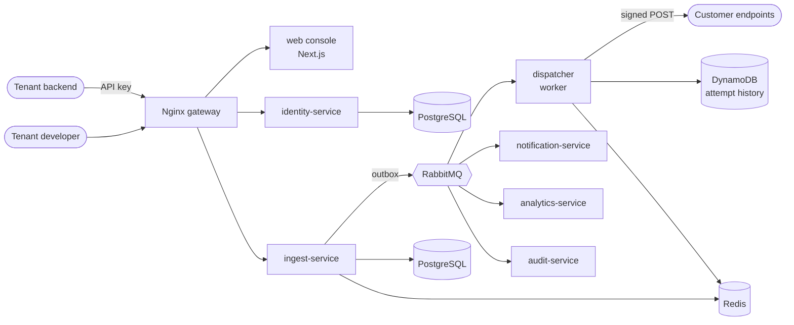

# Solmira

**Reliable webhook delivery for SaaS companies, as a multi-tenant platform.**

A SaaS company (the _tenant_) sends events to Solmira through an API. Solmira delivers each event
as a signed HTTP webhook to every endpoint its customers registered, retries failures with
exponential backoff, keeps one slow endpoint from affecting any other, and lets the tenant inspect
every attempt and replay what failed.

> **Status:** the platform foundation (Phases 1 and 2) and the management API for applications,
> event types, endpoints and API keys (Phase 4), message ingestion, the outbox relay and fan-out
> (Phase 5) are built. The webhook features are being
> built phase by phase; see the [roadmap](docs/ROADMAP.md) and the
> [progress log](docs/phases/PROGRESS.md). Anything not built yet is marked **Planned**.

## The problem

Sending a webhook looks like one HTTP call. Doing it reliably is not:

- receivers are down, slow or misconfigured, and a naive sender retries too hard or gives up too soon;
- one dead endpoint can block a shared queue and delay everyone else;
- a webhook URL is a user-supplied address the platform will call from inside its own network,
  which makes server-side request forgery (SSRF) the main security risk;
- receivers need to verify who sent a request, and signing secrets must be rotatable without downtime;
- when something goes wrong, tenants need to see what was sent, what came back, and replay it.

## Who uses it

| Role                                 | What they do                                                                                                    |
| ------------------------------------ | --------------------------------------------------------------------------------------------------------------- |
| **Tenant developer**                 | Sends events with an API key, registers endpoints for their customers, inspects and replays messages.           |
| **Tenant admin**                     | Manages members, roles and API keys in the console.                                                             |
| **Receiver (the tenant's customer)** | Verifies the signature of each request using the [Standard Webhooks](https://www.standardwebhooks.com/) scheme. |

## How it works

1. The tenant calls `POST /api/v1/applications/{app}/messages` with an API key and an
   `Idempotency-Key`.
2. The message is validated and stored, and an event is written to the transactional outbox in the
   same transaction.
3. Fan-out creates one delivery per subscribed, enabled endpoint.
4. A dispatcher worker sends a signed HTTP POST per delivery. **Planned (Phase 6).**
5. On failure it retries with exponential backoff and jitter. After the final attempt the delivery
   is `failed` and can be replayed; endpoints that keep failing are disabled and the tenant is
   notified. **Planned (Phase 7).**

Delivery is **at least once**. A receiver may see the same message twice, so every request carries
a stable `webhook-id` to deduplicate on.



The dispatcher, DynamoDB history and the analytics, notification and audit consumers are
**Planned**; the diagram shows the target design. See [ARCHITECTURE.md](ARCHITECTURE.md).

## Technology and why

| Choice                                   | Reason                                                                                                                     |
| ---------------------------------------- | -------------------------------------------------------------------------------------------------------------------------- |
| NestJS 12 on Node.js 24 (ESM)            | Structured modules and dependency injection for several services; Node's async I/O suits many slow outbound calls.         |
| PostgreSQL 18, database per service      | Transactions for message and outbox consistency; Row Level Security for tenant isolation; `SKIP LOCKED` for work claiming. |
| RabbitMQ topic exchange                  | Routing and DLQs with publisher confirms; used for fan-out and wake-ups, while delivery state lives in PostgreSQL.         |
| Redis                                    | Rate limits and short-lived counters, where losing data on restart is acceptable.                                          |
| DynamoDB (Planned)                       | High-volume, append-only attempt history with TTL retention, cheaper than keeping it in PostgreSQL.                        |
| Standard Webhooks                        | An open signing specification receivers already have libraries for, instead of an invented scheme.                         |
| Next.js 16, React 19, Tailwind CSS 4     | The management console.                                                                                                    |
| pnpm + Turborepo, Docker, GitHub Actions | One repository, cached builds, reproducible images and CI.                                                                 |

Decisions and the alternatives considered are in the [ADRs](docs/adr/).

## Quick start

Requires Node.js 24, pnpm 10 and Docker. If you used Solmira before the pivot, run
`docker compose down -v` once so the databases are recreated.

```bash
pnpm install
pnpm infra:up                    # Postgres, Redis, RabbitMQ, Mailpit, gateway
for s in identity ingest notification analytics audit; do cp apps/$s-service/.env.example apps/$s-service/.env; done
cp apps/web/.env.example apps/web/.env
pnpm turbo run build --filter=@solmira/identity-service... --filter=@solmira/ingest-service...
pnpm --filter @solmira/identity-service keys:generate   # dev signing keys
pnpm --filter @solmira/identity-service db:migrate      # schema, RLS policies, roles
pnpm --filter @solmira/ingest-service db:migrate
pnpm dev                         # all services and the web app, in watch mode
```

Open **http://localhost:8080**. Full setup, ports and troubleshooting are in
[DEVELOPMENT.md](DEVELOPMENT.md).

## Repository layout

```
apps/        web console + NestJS services (identity, ingest, notification, analytics, audit)
packages/    contracts (shared zod schemas) · service-kit (platform layer for services)
infra/       Dockerfiles, gateway config, Postgres init
docs/        roadmap, ADRs, architecture deep dives, API reference, phase log
```

## Engineering principles

- **The backend decides.** Authorization, tenant scope and state transitions are enforced server-side.
- **The database guards invariants.** Check constraints, composite tenant foreign keys and row-level security back up application code.
- **Assume at-least-once.** Every consumer is idempotent; every event is written in the same transaction as the change it describes.
- **Fail visibly, never leak.** Structured logs with correlation IDs; clients get a stable error envelope and nothing internal.

## Limitations

- The webhook features (applications, endpoints, ingestion, delivery) are not built yet; today the
  repository contains the identity and tenancy platform and the empty ingest service.
- Delivery is at least once, never exactly once. Receivers must deduplicate on `webhook-id`.
- Single region; no multi-region failover is planned.
- No MFA for console users yet.

## Future work

Beyond the [roadmap](docs/ROADMAP.md): per-tenant retention settings, customer-facing endpoint
portals, payload transformations, and a managed multi-region deployment.
