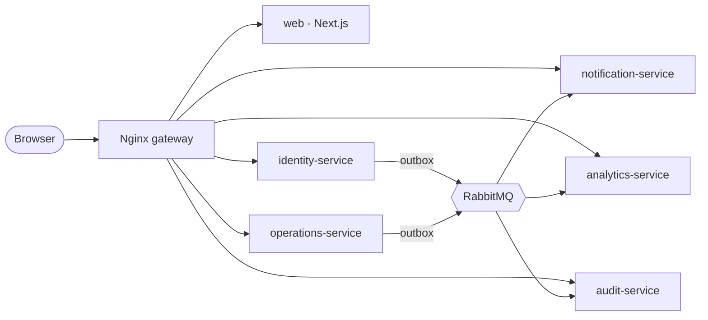

# Solmira

**Multi-tenant order, inventory and fulfillment management for B2B operations teams.**

Solmira runs the operational lifecycle of a distribution business: suppliers, catalog,
multi-warehouse inventory, purchase orders, customer orders, reservations, fulfillment and
shipments. Real-time notifications, analytics and a complete audit trail are built in. It is
designed for correctness under concurrency, strict tenant isolation, and failure-tolerant
event processing.

|               |                                                                                             |
| ------------- | ------------------------------------------------------------------------------------------- |
| **Frontend**  | Next.js 16 (App Router), React 19, TypeScript, Tailwind CSS 4, TanStack Query               |
| **Services**  | NestJS 12 (ESM) on Node.js 24: identity, operations, notification, analytics, audit         |
| **Data**      | PostgreSQL 18 (database per service), Redis 8, DynamoDB (event history)                     |
| **Messaging** | RabbitMQ 4 topic exchange, transactional outbox, idempotent consumers, DLQs                 |
| **Edge**      | Nginx gateway: routing, request/correlation IDs, rate limits, security headers              |
| **Delivery**  | Docker multi-stage images, GitHub Actions, Terraform on AWS (ECS Fargate, RDS, ElastiCache) |

## Status

Built in 12 phases; see [the roadmap](docs/ROADMAP.md).

- [x] **Phase 1: Foundation.** Monorepo, five services on a shared platform layer, gateway, local infrastructure, CI, Docker images.
- [ ] Phase 2: Identity, organizations, RBAC and tenant isolation
- [ ] Phases 3–12: catalog, inventory, purchasing, orders, events, realtime, analytics, audit, testing depth, production readiness

## Architecture at a glance



Services are split along **consistency boundaries**. Order confirmation and inventory reservation
share one ACID transaction inside `operations-service`; everything that can be eventual (notifications,
analytics, audit) is driven by events. The reasoning is in [ARCHITECTURE.md](ARCHITECTURE.md)
and the [ADRs](docs/adr/).

## Quick start

Requires Node.js 24, pnpm 10 and Docker.

```bash
pnpm install
pnpm infra:up                    # Postgres, Redis, RabbitMQ, gateway
cp apps/identity-service/.env.example apps/identity-service/.env   # repeat per service
pnpm dev                         # all services + web, with watch mode
```

Open **http://localhost:8080**. The console opens on the service status page, which checks every
service's readiness through the gateway. Full setup, ports and troubleshooting are in
[DEVELOPMENT.md](DEVELOPMENT.md).

## Repository layout

```
apps/        web + five NestJS services
packages/    contracts (shared zod schemas) · service-kit (platform layer for services)
infra/       Dockerfiles, gateway config, Postgres init
docs/        roadmap, ADRs, architecture deep dives, runbooks
```

## Engineering principles

- **The backend decides.** Authorization, tenant scope and state transitions are enforced server-side; the UI only reflects them.
- **The database guards invariants.** Check constraints, composite tenant foreign keys and row-level security back up application code.
- **Assume at-least-once.** Every consumer is idempotent; every event is written in the same transaction as the change it describes.
- **Fail visibly, never leak.** Structured logs with correlation IDs server-side; clients get a stable error envelope and nothing internal.
