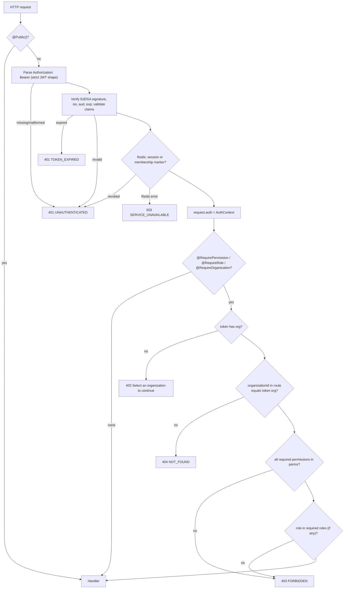

# Authorization

Status: **Built** (phase 2). Related: [authentication](authentication.md),
[tenant isolation](tenant-isolation.md), [ADR-0006](../adr/0006-multi-tenancy-shared-schema.md).

Authorization answers one question per request: may this user do this action in the organization
named by their access token? The answer comes from permissions, never from role names, and the
tenant comes from the token, never from request input.

## Code map

| Concern                                     | Location                                                                 |
| ------------------------------------------- | ------------------------------------------------------------------------ |
| Permission catalog, roles, management rules | `packages/contracts/src/access.ts`                                       |
| Guard and decorators                        | `packages/service-kit/src/auth/auth.guard.ts`, `decorators.ts`           |
| Auth context types                          | `packages/service-kit/src/auth/auth-context.ts`                          |
| Catalog sync on deploy                      | `apps/identity-service/src/database/migrations.ts` (`syncAccessCatalog`) |
| Resolving role and permissions for a token  | `apps/identity-service/src/auth/access-context.service.ts`               |
| Membership management rules                 | `apps/identity-service/src/organizations/members.service.ts`             |
| Invitations                                 | `apps/identity-service/src/organizations/invitations.service.ts`         |
| Permission-aware UI                         | `apps/web/src/components/auth/can.tsx`                                   |

## Permission catalog: one source of truth

`PERMISSION_CATALOG` in `@solmira/contracts` lists every permission as `resource.action` with a
description (32 today, covering organizations, users, roles, products, suppliers, warehouses,
inventory, purchase orders, orders, shipments, analytics and audit logs). The same object is used by:

- **identity-service**, which syncs it into the database on every deploy;
- **the guard**, whose `@RequirePermission(...)` accepts only the `Permission` type, so a typo is a
  compile error;
- **the web app**, which uses the same keys to shape the UI.

`syncAccessCatalog` runs after migrations, as the schema owner role, in one transaction:
upserts every permission, deletes permissions that are no longer in the catalog, upserts the five
system roles (`roles.organization_id IS NULL`) with name, description and rank, and rewrites each
role's rows in `role_permissions`. It is idempotent. The runtime role can only read these tables
(see [tenant isolation](tenant-isolation.md#the-access-catalog-read-only-at-runtime)), so the running
service cannot grant itself anything.

Adding a feature means adding its permissions to the catalog and to the relevant roles in
`ROLE_DEFINITIONS`; the next deploy applies it everywhere.

## Roles and ranks

| Role      | Rank | Permissions                                                                                                                                                       |
| --------- | ---- | ----------------------------------------------------------------------------------------------------------------------------------------------------------------- |
| `OWNER`   | 50   | All                                                                                                                                                               |
| `ADMIN`   | 40   | All                                                                                                                                                               |
| `MANAGER` | 30   | All operational permissions plus `users.read`, `roles.read`, `audit_logs.read`; not `organizations.update`, `users.create/update/delete`, `roles.assign`          |
| `STAFF`   | 20   | Read operations plus `inventory.adjust`, `inventory.reserve`, `purchase_orders.receive`, `orders.create`, `orders.update`, `shipments.create`, `shipments.update` |
| `VIEWER`  | 10   | Read operations only (`organizations.read` and the `*.read` of operational resources and `analytics.read`)                                                        |

Owner and admin have the same permissions. They differ only in **rank**, which governs who can
manage whom. Rank is used for assignment rules and never for access checks.

## Checks are by permission, not by role

Controllers declare what an action needs (`@RequirePermission('users.delete')`), not who may do it.
Changing which roles can remove members is a change to `ROLE_DEFINITIONS`, not a code search for
`role === 'ADMIN'`. `@RequireRole` exists but is documented as "rarely needed; prefer permissions"
and no route uses it today.

The permissions checked are the `perms` claim of the access token, which identity-service resolved
from `organization_members → roles → role_permissions` when it issued the token
(`AccessContextService.resolve`). A token is only issued with an `org` claim for an **active**
membership in an **active** organization.

## The guard and decorator order

`AuthGuard` is a single global guard (`APP_GUARD`, registered by `AuthModule.forRoot`) that does
authentication, tenant context and permission checks in a fixed order, so no route can run one
check without the others.

| Decorator                  | Meaning                                                                                                   |
| -------------------------- | --------------------------------------------------------------------------------------------------------- |
| _(none)_                   | Authenticated user, organization optional (for example `GET /me`, `POST /organizations`)                  |
| `@Public()`                | Explicit, greppable opt-out: auth, register, login, refresh, logout, JWKS, health                         |
| `@RequireOrganization()`   | Token must carry an organization; a route `:organizationId` must equal it                                 |
| `@RequirePermission(...p)` | All listed permissions required (class and handler metadata are merged); implies `@RequireOrganization()` |
| `@RequireRole(...r)`       | One of the roles required; implies `@RequireOrganization()`                                               |
| `@CurrentAuth()`           | Injects the `AuthContext`; typed as `TenantAuthContext` on organization routes                            |

Authentication is on by default: forgetting a decorator makes a route require a token, never
makes it public.

## Routes in identity-service

| Route                                                     | Requirement                                                 |
| --------------------------------------------------------- | ----------------------------------------------------------- |
| `POST /organizations`                                     | authenticated; the creator becomes `OWNER`                  |
| `GET /organizations`, `GET /me`                           | authenticated; the caller's own memberships                 |
| `GET /organizations/:organizationId`                      | `organizations.read`                                        |
| `PATCH /organizations/:organizationId`                    | `organizations.update`                                      |
| `GET /organizations/:organizationId/members`              | `users.read`                                                |
| `PATCH /organizations/:organizationId/members/:memberId`  | `@RequireOrganization()` + per-field checks (below)         |
| `DELETE /organizations/:organizationId/members/:memberId` | `users.delete` + management rules                           |
| `GET /organizations/:organizationId/invitations`          | `users.read`                                                |
| `POST /organizations/:organizationId/invitations`         | `users.create` + role must be assignable by the caller      |
| `DELETE /organizations/:organizationId/invitations/:id`   | `users.create`                                              |
| `POST /invitations/accept`                                | authenticated; signed-in email must equal the invited email |
| `GET /roles`                                              | `roles.read`                                                |
| `GET /permissions`                                        | authenticated; the catalog                                  |

## Per-field checks on member PATCH

`PATCH .../members/:memberId` accepts `{ role?, status? }` (at least one). One endpoint changes
two things that need different permissions, so a single decorator would be either too strict or
too loose. The route only requires an organization; `MembersService.update` checks:

- `role` present → requires `roles.assign`;
- `status` present → requires `users.update`.

A manager can see members (`users.read`) but has neither permission, so both changes are `403`
(integration test: "requires roles.assign to change roles, even for a manager who can see the member").

## Membership management rules

Shared as pure functions in `access.ts`, enforced by `MembersService` and `InvitationsService`:

- **Rank.** `canManageMember(actor, target)`: an owner can manage anyone, including other owners;
  everyone else only members ranked **strictly below** them. An admin cannot manage another admin
  or an owner.
- **Assignable roles.** `assignableRoles(actor)`: an owner can grant any role; everyone else only
  roles ranked below their own. An admin can invite or promote up to `MANAGER`, never to `ADMIN`
  or `OWNER`. The same rule applies to invitations.
- **No self-change.** Changing, suspending or removing your own membership is `403 "You cannot
change your own membership"`.
- **Last active owner.** Demoting, suspending or removing an owner requires at least one _other_
  active owner to remain, otherwise `409 CONFLICT "An organization needs at least one active owner"`.
  With self-changes forbidden the acting owner usually satisfies this already; the explicit count
  keeps the invariant true if the surrounding rules change.
- **Tenant-scoped lookup.** The target is loaded with `SELECT ... FOR UPDATE` filtered by the
  caller's organization inside a tenant-scoped transaction. A member id from another organization
  is `404`, indistinguishable from a random id. The row lock serialises concurrent changes to the
  same member.
- **Invitations** can only be redeemed by an account whose email equals the invited email
  (`403` otherwise); they are single-use, expire after 7 days and can be revoked. Only one pending
  invitation per `(organization, lower(email))` is allowed (partial unique index), and inviting an
  existing member is `409`.

Every change writes an outbox event (`member.role_changed`, `member.status_changed`,
`member.removed`, `member.invited`, `member.joined`) with the actor and organization.

## Role changes take effect immediately

The access token carries a snapshot of role and permissions, so a role change must reach tokens
already issued. After a role change, suspension or removal commits, `MembersService` calls
`revokeMembership(organizationId, userId)`, which writes
`auth:revoked:member:<org>:<user> = <now in ms>` to Redis. The guard rejects every token of that
user for that organization with `iat_ms <= marker` with `401`. The client refreshes; refresh
re-resolves membership from the database and issues a token with the new role, or with no
organization if the member was suspended or removed.

Proven by the authorization suite: "applies a role change immediately: old tokens stop working,
refreshed ones carry the new role", "suspension removes access to the organization but not to
the account", and "only users.delete may remove members, and removal is effective at once".
See [authentication](authentication.md#lessons-learned) for why the cut-off uses millisecond
precision.

## Status codes

| Situation                                                     | Status |
| ------------------------------------------------------------- | ------ |
| No, malformed, forged, expired or revoked token               | 401    |
| Token valid but no active organization on a tenant route      | 403    |
| Resource or organization id belongs to another tenant         | 404    |
| Resource exists in your organization, permission missing      | 403    |
| Rank, self-change or assignable-role rule violated            | 403    |
| Last-owner invariant would break, duplicate invitation/member | 409    |

## Frontend permission-aware UI is UX only

`usePermissions()` and `<Can permission="...">` in `apps/web/src/components/auth/can.tsx` read the
`permissions` of `activeOrganization` from the current session and hide controls the user cannot
use. The member screens also call `canManageMember` and `assignableRoles` from contracts so the UI
offers only the roles the API would accept. None of this is a security boundary: a user who
edits the page still hits the same guard and service checks, and the API is tested directly
without the UI. The session hint cookie and the Next.js proxy likewise only route; they grant nothing.

## Known limitations

- System roles only. The schema allows organization-specific roles (`roles.organization_id` not
  null, readable only within that organization), but no API creates them yet.
- `perms` grows with the catalog. With 32 permissions the token is small; if the catalog grows by
  an order of magnitude, a permission-set version in the token with a lookup cache is the next step.
- Services other than identity adopt the guard as their routes are built; until then they expose
  only public health routes.
