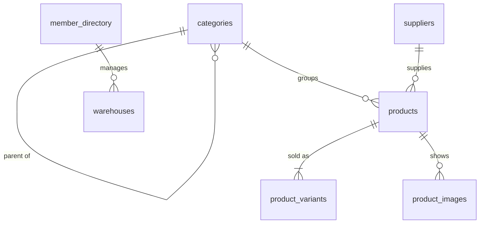

# Catalog, suppliers and warehouses

Phase 3 of operations-service: products, variants, categories, suppliers, warehouses and product
images. Decisions and their reasons are in ADRs
[0013](../adr/0013-catalog-modeling.md) (modeling),
[0015](../adr/0015-sku-uniqueness.md) (SKUs),
[0016](../adr/0016-warehouses-and-managers.md) (warehouses and managers) and
[0017](../adr/0017-product-image-storage.md) (images); storage is described in
[object-storage.md](object-storage.md). Inventory quantities and reservations are **not** part of
this phase (phase 4).

## Data model

Every table has `organization_id`, a unique key `(organization_id, id)`, Row Level Security with
one `FOR ALL` policy `organization_id = app_current_organization_id()`, and composite foreign keys
for every reference.

| Table              | Purpose                                                  | Key constraints                                                                                                                                                                                                    |
| ------------------ | -------------------------------------------------------- | ------------------------------------------------------------------------------------------------------------------------------------------------------------------------------------------------------------------ |
| `categories`       | Tree of up to three levels                               | `categories_org_slug_key`, `categories_parent_fk` (composite, `RESTRICT`), `categories_not_own_parent_check`, `categories_status_check`                                                                            |
| `suppliers`        | Companies the organization buys from                     | `suppliers_org_company_name_key` on `lower(company_name)`, payment terms, lead time (0–365) and country checks                                                                                                     |
| `warehouses`       | Stock locations                                          | `warehouses_org_code_key`, `warehouses_code_check`, `warehouses_manager_fk` (composite to `member_directory`, `ON DELETE SET NULL (manager_member_id)`)                                                            |
| `products`         | Shared product data, base price and cost                 | `products_org_slug_key`, `products_category_fk` and `products_supplier_fk` (composite), status, tax, currency, money and dimension checks, `products_archived_at_check`                                            |
| `product_variants` | Sellable units                                           | `product_variants_product_fk` (composite), `product_variants_org_sku_live_key` and `product_variants_org_barcode_live_key` (partial, `status <> 'ARCHIVED'`), `product_variants_sku_normalised_check`, money check |
| `product_images`   | Image metadata; bytes are in object storage              | `product_images_product_fk` (composite, `CASCADE`), `product_images_key_prefix_check` (key must start with `organizations/{org}/products/{product}/`), content type and size checks                                |
| `member_directory` | Organization members verified by identity (for managers) | Primary key `(organization_id, member_id)`                                                                                                                                                                         |
| `outbox_events`    | Catalog events, written in the business transaction      | `outbox_events_unpublished_idx`; publishing is phase 7                                                                                                                                                             |

Schema: `apps/operations-service/src/database/schema.ts` → generated
`drizzle/0000_catalog_schema.sql`. Hand-written `drizzle/0001_tenant_security_and_search.sql`
adds the tenant function, RLS policies, the manager foreign key, the `pg_trgm` and `btree_gin`
extensions and the trigram indexes.

### Indexes and access patterns

| Access pattern                               | Index                                                                                    |
| -------------------------------------------- | ---------------------------------------------------------------------------------------- |
| Product list, default sort, status filter    | `products_org_status_updated_idx`, `products_org_updated_idx`                            |
| Filter by category, supplier, brand          | `products_org_category_idx`, `products_org_supplier_idx`, `products_org_brand_idx`       |
| Sort or range by price, by creation date     | `products_org_price_idx`, `products_org_created_idx`                                     |
| Substring search (name, brand, SKU, company) | GIN trigram indexes `(organization_id, <column> gin_trgm_ops)` on each searched column   |
| Variants of a product, images of a product   | `product_variants_org_product_idx`, `product_images_org_product_idx` (with `sort_order`) |
| Exact SKU lookup, uniqueness                 | `product_variants_org_sku_live_key`                                                      |
| Child categories                             | `categories_org_parent_idx`                                                              |

Every index leads with `organization_id`, which RLS adds to every query anyway.

## API

All routes are under `/api/v1`, require a verified access token with an active organization,
and check a permission. The tenant comes only from the token; ids of other organizations answer
`404`. Bodies and queries are validated with the zod schemas in `@solmira/contracts/catalog`
(unknown keys are stripped).

| Route                                                                               | Permission                             | Notes                                                          |
| ----------------------------------------------------------------------------------- | -------------------------------------- | -------------------------------------------------------------- |
| `GET/POST /categories`, `GET/PATCH/DELETE /categories/:id`                          | `categories.read/create/update/delete` | Delete only when empty (`409` otherwise)                       |
| `GET/POST /suppliers`, `GET/PATCH /suppliers/:id`                                   | `suppliers.read/create/update`         | `DELETE` deactivates (`suppliers.delete`)                      |
| `GET /suppliers/:id/products`                                                       | `suppliers.read` + `products.read`     |                                                                |
| `GET/POST /warehouses`, `GET/PATCH /warehouses/:id`                                 | `warehouses.read/create/update`        | `managerMemberId` verified with identity; `DELETE` deactivates |
| `GET/POST /products`, `GET/PATCH /products/:id`                                     | `products.read/create/update`          | `DELETE` archives (`products.delete`)                          |
| `POST /products/bulk-status`                                                        | `products.update`                      | Up to 100 ids; returns `updated` and `skipped` with reasons    |
| `GET/POST /products/:id/variants`, `PATCH/DELETE /products/:id/variants/:variantId` | `products.read/create/update/delete`   | `DELETE` archives and frees the SKU                            |
| `GET/POST /products/:id/images`                                                     | `products.read` / `products.update`    | Multipart upload, 5 MB, JPEG/PNG/WebP by content               |
| `PATCH/DELETE /products/:id/images/:imageId`                                        | `products.update`                      | Alt text; delete renumbers the rest                            |
| `POST /products/:id/images/reorder`                                                 | `products.update`                      | Must list every image once                                     |

### Lists

Query parameters: `page` (default 1), `pageSize` (1–100, default 25), `sort` and `direction` from
a whitelist, `search`, and per-resource filters. Products: `status`, `categoryId`, `supplierId`,
`brand`, `sku` (exact, normalised), `minPrice`/`maxPrice` (minor units), `createdFrom`/`createdTo`.
Invalid values (unknown sort field, `pageSize=500`, a non-UUID filter, `minPrice > maxPrice`) are
`400 VALIDATION_FAILED`, never silently ignored. Responses are
`{ items, page, pageSize, total, totalPages }`.

Search is a case-insensitive substring match: products by name, brand, category name, supplier
name, or any variant's SKU; `%` and `_` are escaped. Each page is one query for the rows (with
correlated sub-selects for variant count and primary SKU) plus one `count(*)`.

### Rules enforced by the API

- Product status transitions follow `PRODUCT_STATUS_TRANSITIONS`; activation needs an active
  variant; an active product keeps at least one active variant (`409` otherwise).
- Categories: at most three levels, no cycles, parent must be an active category of the same
  organization.
- Products may only reference active categories and suppliers of the same organization (`400`).
- Warehouse managers must be active members of the same organization (verified with identity,
  then stored in `member_directory`).
- Archived products and their variants and images are read-only until restored.

## Events

Each write records one or more events in `outbox_events` in its transaction:
`category.created/updated/deleted`, `product.created/updated/status_changed`,
`variant.created/updated/status_changed`, `product_image.added/removed`,
`supplier.created/updated/status_changed`, `warehouse.created/updated/status_changed`.
Payload types are in `CatalogEventPayloads` (`packages/contracts/src/events.ts`). They are not
published yet; the relay and consumers are phase 7.

## Authentication in operations-service

operations-service verifies Ed25519 access tokens with identity's public JWKS
(`IDENTITY_JWKS_URL`, cached 10 minutes, 3-second fetch timeout) and never holds the private key.
Session and membership revocation markers in Redis apply exactly as in identity. The only call
from operations to identity is the manager lookup, which forwards the caller's own token.

## Web console

| Page                             | What it does                                                                                                                                                                                           |
| -------------------------------- | ------------------------------------------------------------------------------------------------------------------------------------------------------------------------------------------------------ |
| `/products`                      | Data table (TanStack Table): search, status, category and supplier filters, more filters (brand, SKU, price, dates), sort, pagination, column choices, row selection, bulk activate/deactivate/archive |
| `/products/new`                  | Reusable product form (react-hook-form + zod), optional first variant                                                                                                                                  |
| `/products/:id`                  | Tabs: Overview (edit form), Variants, Images (upload with progress, preview, reorder, primary, alt text, delete), Supplier, Activity                                                                   |
| `/categories`                    | Tree with add subcategory, edit, archive or restore, delete                                                                                                                                            |
| `/suppliers`, `/suppliers/:id`   | List, create, edit, deactivate, products from the supplier                                                                                                                                             |
| `/warehouses`, `/warehouses/:id` | List, create, edit, manager assignment, deactivate                                                                                                                                                     |

List state (page, sort, filters) lives in the URL, parsed with the API's own schemas, so links
are shareable and a tampered URL falls back to defaults. Query keys start with
`['org', organizationId, 'catalog']`: switching organizations never shows cached data of another
one, and every write invalidates the organization's catalog. Actions are shown only when the
active role has the permission; the API enforces it regardless. Money is entered as text and
converted to minor units with each currency's number of decimals; edits send only changed fields.

The Activity tab shows the record's own lifecycle (created, last changed, archived). The full
change history comes from the audit service in phase 10.

## Tests

| Suite                                             | What it proves                                                                                                                                                                                                                                                          |
| ------------------------------------------------- | ----------------------------------------------------------------------------------------------------------------------------------------------------------------------------------------------------------------------------------------------------------------------- |
| `test/database.integration.test.ts` (26)          | RLS on all seven tables as the runtime role (default deny, cross-tenant read/insert/update/move), composite foreign keys even as owner, SKU and code uniqueness per tenant, archived SKU reuse, SKU normalisation check, image key prefix check                         |
| `test/catalog.integration.test.ts` (23)           | CRUD and rules over HTTP: category depth, cycles and delete protection, supplier validation, product lifecycle, last active variant, duplicate SKU, bulk status, pagination, sort, filters, search, invalid queries, warehouse codes, manager assignment, outbox events |
| `test/catalog-isolation.integration.test.ts` (15) | Organization B cannot list, read, update, delete, reference, or add variants to A's records; smuggled `organizationId` ignored; 401 for missing, forged and expired tokens; 403 without organization or permission; malformed ids                                       |
| `test/images.integration.test.ts` (10)            | Real MinIO: upload, signed read, unsigned read `403`, key layout, content validation, `413`, reorder, alt text, delete removes the object, cross-tenant `404`, read-only roles                                                                                          |
| Unit tests                                        | Image sniffing and file names, category placement rules, query helpers, member lookup adapter, contracts schemas, web form mapping, money, category tree, list parameters, navigation                                                                                   |

The integration suites run the real application as the RLS-restricted runtime role against real
PostgreSQL, Redis and MinIO, with tokens verified through a real JWKS endpoint. Only the
identity member lookup is replaced by an in-process fake at the service boundary (the HTTP
adapter has its own unit test, and the real path was verified end to end in the containerized
stack).

## Known limitations

- Pick lists (categories, suppliers) load up to 100 entries; larger catalogs need typeahead.
- `member_directory` is refreshed only when a manager is assigned, until member events arrive in
  phase 7.
- Offset pagination can skip or repeat rows when data changes between page loads.
- Images are not re-encoded or stripped of EXIF metadata; there is no orphan sweeper yet.
