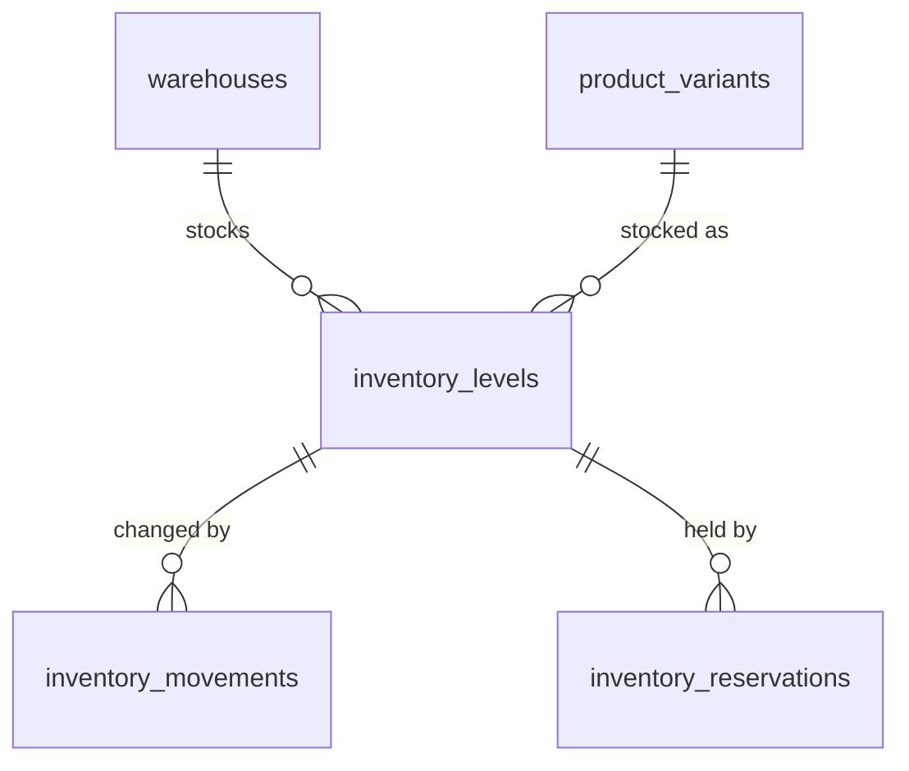

# Inventory

Phase 4 of operations-service: stock levels per warehouse and variant, an append-only movement
ledger, adjustments and counts, transfers, reservations and low-stock detection. Decisions and
their reasons are in ADRs [0018](../adr/0018-inventory-ledger-and-counters.md) (counters and
ledger), [0019](../adr/0019-stock-movement-rules.md) (movement rules) and
[0020](../adr/0020-reservations-and-oversell-prevention.md) (reservations and overselling).
Purchase-order receiving (phase 5) and order reservations and shipments (phase 6) build on it.

## Data model



| Table                    | Purpose                                                     | Key constraints                                                                                                                                                                                                                                   |
| ------------------------ | ----------------------------------------------------------- | ------------------------------------------------------------------------------------------------------------------------------------------------------------------------------------------------------------------------------------------------- |
| `inventory_levels`       | Current stock of one variant in one warehouse               | `inventory_levels_org_warehouse_variant_key`; composite FKs to `warehouses` and `product_variants` (`RESTRICT`); `inventory_levels_quantities_check` (`0 <= reserved <= on_hand <= 1,000,000,000`); `available` generated as `on_hand - reserved` |
| `inventory_movements`    | Append-only ledger: one row per change, with balances after | Composite FK to the level; `sequence` identity (apply order); type/reason, one-counter-one-direction, balance and reference checks; `SELECT` + `INSERT` RLS policies only; triggers refuse `UPDATE`, `DELETE`, `TRUNCATE` for every role          |
| `inventory_reservations` | Holds on stock (`ACTIVE` → `RELEASED`)                      | Composite FK to the level; quantity `> 0`; `released_at` set exactly when released                                                                                                                                                                |

Schema: `apps/operations-service/src/database/schema.ts` → generated
`drizzle/0002_inventory_schema.sql`. Hand-written `drizzle/0003_inventory_security_and_ledger.sql`
adds RLS, the append-only triggers and the partial low-stock index.

| Access pattern                         | Index                                                                         |
| -------------------------------------- | ----------------------------------------------------------------------------- |
| Stock of a variant in a warehouse      | `inventory_levels_org_warehouse_variant_key` (also the upsert target)         |
| Stock of a variant across warehouses   | `inventory_levels_org_variant_idx`                                            |
| Low-stock list                         | `inventory_levels_org_low_stock_idx` (partial: at or under reorder point)     |
| Ledger of one level, newest first      | `inventory_movements_org_level_sequence_idx`                                  |
| Organization ledger, date range        | `inventory_movements_org_sequence_idx`, `inventory_movements_org_created_idx` |
| Movements of a transfer or reservation | `inventory_movements_org_reference_idx`                                       |
| Active reservations                    | `inventory_reservations_org_status_created_idx`                               |

## The write path

Every change to stock goes through `applyStockChange` in
`apps/operations-service/src/inventory/stock-ledger.ts`, in the request's tenant transaction:

1. `UPDATE inventory_levels SET on_hand = on_hand + Δh, reserved = reserved + Δr` with the guard
   `on_hand + Δh >= reserved + Δr AND reserved + Δr >= 0 AND on_hand + Δh <= 1,000,000,000`.
   Zero rows means the guard failed; the caller answers `409 INSUFFICIENT_STOCK` (or `400` for
   the ceiling) and the transaction rolls back.
2. `INSERT inventory_movements` with both deltas, the balances returned by step 1, type, reason,
   reference, note, actor and correlation id.
3. If available stock crossed down through the reorder point, write `inventory.low_stock` to the
   outbox.

Operations that touch several levels (transfers, multi-line reservations) apply step 1 in
ascending level-id order, so concurrent requests lock rows in the same sequence and cannot
deadlock. The counters are hot rows by design: PostgreSQL's row lock serializes writers to one
level, and the guard is re-evaluated after each wait. The full concurrency argument is in
ADR-0020.

## API

All routes are under `/api/v1/inventory`, require a verified access token with an active
organization and check a permission. Bodies and queries are validated with the zod schemas in
`packages/contracts/src/inventory.ts`.

| Route                            | Permission          | Notes                                                                                                                              |
| -------------------------------- | ------------------- | ---------------------------------------------------------------------------------------------------------------------------------- |
| `GET /levels`                    | `inventory.read`    | `search` (SKU, variant, product), `warehouseId`, `productId`, `variantId`, `lowStock`, sort `sku`/`onHand`/`available`/`updatedAt` |
| `GET /levels/:id`                | `inventory.read`    |                                                                                                                                    |
| `PATCH /levels/:id`              | `inventory.adjust`  | `{ reorderPoint: number \| null }`; configuration, no ledger row                                                                   |
| `GET /movements`                 | `inventory.read`    | Newest first; `warehouseId`, `variantId`, `type`, `from`/`to` (a date-only `to` includes that day)                                 |
| `POST /adjustments`              | `inventory.adjust`  | `reason` + `quantityChange`, or `COUNT` + `countedQuantity`; creates the level on first receipt                                    |
| `POST /transfers`                | `inventory.adjust`  | Immediate; two movements sharing `transferId`                                                                                      |
| `GET /reservations`              | `inventory.read`    | `status`, `warehouseId`, `variantId`, `search` (reference)                                                                         |
| `POST /reservations`             | `inventory.reserve` | Up to 50 lines, each warehouse and variant once; all or nothing                                                                    |
| `POST /reservations/:id/release` | `inventory.reserve` | Idempotent: releasing twice returns the released reservation                                                                       |

Errors:

| Situation                                                | Response                                                                               |
| -------------------------------------------------------- | -------------------------------------------------------------------------------------- |
| Not enough available stock (or a count below reserved)   | `409 INSUFFICIENT_STOCK`, details per field, e.g. `lines.1.quantity: Only 1 available` |
| Direction contradicts the reason, zero change, fractions | `400 VALIDATION_FAILED` on `quantityChange` / `countedQuantity`                        |
| Adding stock to an inactive warehouse or variant         | `400` on `warehouseId` / `variantId` / `toWarehouseId`                                 |
| Increase past 1,000,000,000 units                        | `400` "Stock cannot exceed 1,000,000,000 units"                                        |
| Warehouse or variant of another organization             | `400` "… not found" on the field (indistinguishable from a random id)                  |
| Level or reservation of another organization             | `404`                                                                                  |

## Rules

- A reason fixes the direction of an adjustment (`adjustmentIssue` in contracts, shared with the
  console). A count's change is computed under the level lock; a count that matches writes
  nothing.
- On hand never falls below reserved; release a reservation before writing off its units.
- Adding and reserving need an active warehouse and an active variant of a non-archived product;
  taking stock out is always allowed.
- Stocked warehouses and variants cannot be deleted; they retire through their statuses.

## Events

Written to `outbox_events` in the same transaction (`InventoryEventPayloads` in
`packages/contracts/src/events.ts`); the relay publishes them from phase 7.

| Event                   | When                                                 |
| ----------------------- | ---------------------------------------------------- |
| `inventory.adjusted`    | Every adjustment that changed stock                  |
| `inventory.transferred` | Every transfer                                       |
| `inventory.reserved`    | Every reservation request (all its lines)            |
| `inventory.released`    | Every release that changed stock                     |
| `inventory.low_stock`   | Available crosses down to or below the reorder point |

## Reconciliation

The counters can be rebuilt from the ledger at any time. This query must return no rows:

```sql
select l.id, l.on_hand, l.reserved,
       coalesce(sum(m.on_hand_change), 0)  as ledger_on_hand,
       coalesce(sum(m.reserved_change), 0) as ledger_reserved
  from inventory_levels l
  left join inventory_movements m on m.inventory_level_id = l.id
 group by l.id
having l.on_hand  <> coalesce(sum(m.on_hand_change), 0)
    or l.reserved <> coalesce(sum(m.reserved_change), 0);
```

and `reserved` equals the sum of `ACTIVE` reservations per level. Both checks run at the end of
the integration suite.

## Web console

- **Inventory** (`/inventory`): stock levels with search, warehouse filter, low-stock toggle,
  sorting and pagination (URL-synced). Row actions by permission: adjust (reason-aware form with
  a live "on hand after" preview), transfer, reorder point, reserve, view movements. "Add stock"
  receives a variant into a warehouse for the first time.
- **Stock movements** (`/inventory/movements`): the ledger with type, reason, signed changes and
  balances after; filters for warehouse, type and dates.
- **Reservations** (`/inventory/reservations`): active and released holds, release with
  confirmation.
- Warehouse and product pages link to their stock.

The console mirrors the API rules for fast feedback; the API enforces them.

## Tests

- `test/inventory.integration.test.ts`: adjustments, counts, direction rules, the reserved floor,
  the stock ceiling, catalog status rules, transfers (atomic, failure leaves nothing), multi-line
  all-or-nothing reservations, release idempotency, low-stock crossing, permissions, and the
  concurrency cases (30 racing reservations for 10 units, uneven batches, opposite transfers
  without deadlock, concurrent write-offs), ending with ledger reconciliation.
- `test/inventory-isolation.integration.test.ts`: organization B with an owner token and A's real
  ids cannot list, read, adjust, transfer, reserve, release or mix A's warehouses and variants.
- `test/database.integration.test.ts`: RLS on the three tables, append-only ledger for the runtime
  role and the owner, composite foreign keys, counter and movement `CHECK`s, generated
  `available`.
- `packages/contracts/src/inventory.test.ts`: reasons, directions, request and query schemas.
- `apps/web`: labels, quantity formatting and the form value builders.

## Known limitations

- Adjustments and reservations are not idempotent yet; phase 6 adds `Idempotency-Key`.
- Transfers are immediate; there is no in-transit state.
- Movement actors are user ids; names arrive with member events (phase 7).
- Reservations do not expire.
