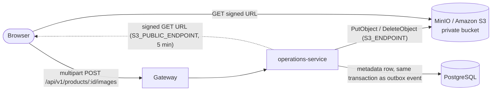

# Object storage and product media

How operations-service stores product images. Decisions: ADR-0014 (storage abstraction) and
ADR-0017 (image uploads and metadata).

## Components

- `ObjectStorage` port: `put`, `delete`, `signedReadUrl`, `ping`.
- `S3ObjectStorage` adapter: AWS SDK v3. One client for requests (`S3_ENDPOINT`), one for
  signing (`S3_PUBLIC_ENDPOINT`, falling back to `S3_ENDPOINT`), both path-style when
  `S3_FORCE_PATH_STYLE=true` (MinIO).
- Health: `object-storage` check (`HeadBucket`), reported with `critical: false`.

## Configuration

| Variable                                    | Local (host)            | Compose (containers)    | AWS                          |
| ------------------------------------------- | ----------------------- | ----------------------- | ---------------------------- |
| `S3_BUCKET`                                 | `solmira-media`         | `solmira-media`         | per environment              |
| `S3_REGION`                                 | `us-east-1`             | `us-east-1`             | bucket region                |
| `S3_ENDPOINT`                               | `http://localhost:9000` | `http://minio:9000`     | unset                        |
| `S3_PUBLIC_ENDPOINT`                        | unset                   | `http://localhost:9000` | unset (or a CDN in phase 12) |
| `S3_FORCE_PATH_STYLE`                       | `true`                  | `true`                  | `false`                      |
| `S3_ACCESS_KEY_ID` / `S3_SECRET_ACCESS_KEY` | MinIO root (dev only)   | MinIO root (dev only)   | unset: task role             |
| `IMAGE_URL_TTL_SECONDS`                     | `300`                   | `300`                   | `300`                        |

## Upload flow

1. Multer reads the part into memory with limits (1 file, 5 MB, 5 fields); larger bodies are
   rejected with `413`.
2. `validateImageUpload`: detect JPEG/PNG/WebP from magic bytes; reject anything else (including
   SVG); require the extension to match; sanitise the display name.
3. Transaction as the tenant: lock the product (`FOR UPDATE`), refuse archived products and the
   13th image, `PutObject` to `organizations/{org}/products/{product}/{imageId}`, insert the row
   with the next `sort_order`, record `product_image.added`.
4. If any step after `PutObject` fails, delete the object (best effort) and return the error.

## Read flow

`GET /products/:id/images` returns rows in `sort_order` with a signed URL and its expiry for each.
The browser loads the image straight from storage. The web app refreshes the list every four
minutes and once when an image fails to load, so URLs are renewed before or right after they
expire.

## Delete and reorder

- Delete: in one transaction, lock the product, delete the row, renumber the rest to `0..n-1`,
  record `product_image.removed`; after commit, delete the object. A failure there is logged and
  leaves an orphan object, never a dangling row.
- Reorder: the request must name every image once; positions are rewritten in one transaction.
- Deleting a product row (not done by the API, which archives) cascades to its image rows.

## Security properties

| Threat                                   | Control                                                                                      |
| ---------------------------------------- | -------------------------------------------------------------------------------------------- |
| Script disguised as an image (SVG, HTML) | Type detected from bytes; SVG not accepted; stored `Content-Type` is the detected one        |
| Path traversal or overwriting via name   | Keys are generated; the original name is display text only                                   |
| Cross-tenant object access               | Key prefix from the token's organization; `product_images_key_prefix_check`; RLS on metadata |
| Public exposure                          | Private bucket; 5-minute signed reads; keys never returned                                   |
| Resource exhaustion                      | 5 MB per file, one file per request, 12 images per product, gateway body limit 10 MB         |

## Local setup

`pnpm infra:up` starts `minio` (API `:9000`, console `:9001`, user `solmira`, password from
`MINIO_ROOT_PASSWORD`, default `solmira_dev_minio_password`) and the one-off `minio-init`, which
creates the private bucket. Integration tests create their own bucket, `solmira-test-media`.

## Operations

- Orphans can come from crashes between storage and database steps; a sweeper that lists keys and
  removes those without rows is planned for phase 12.
- Buckets on AWS will have Block Public Access, default encryption, versioning and lifecycle
  rules, provisioned by Terraform (phase 12).
