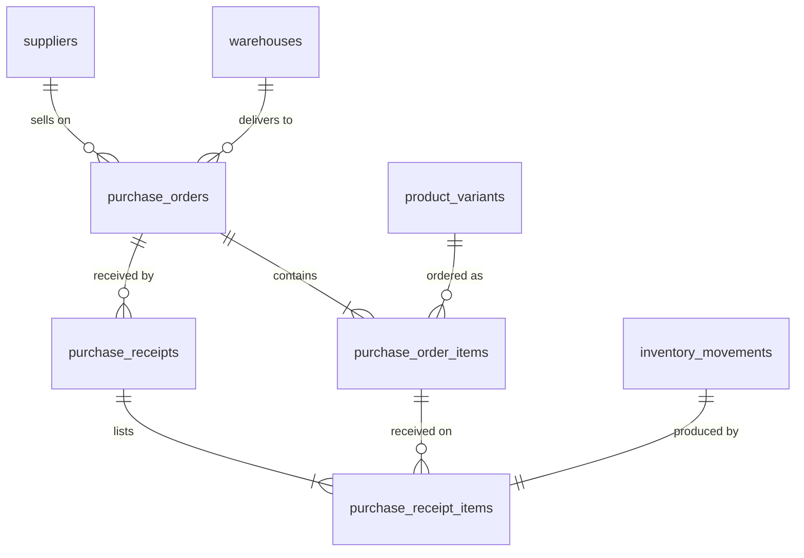

# Purchasing and receiving

Phase 5 of operations-service: purchase orders from suppliers, an approval workflow, and
receiving that puts stock into a warehouse through the inventory ledger. Decisions and their
reasons are in ADRs [0021](../adr/0021-purchase-order-model-and-lifecycle.md) (model, lifecycle,
money) and [0022](../adr/0022-transactional-idempotent-receiving.md) (transactional, concurrent,
idempotent receiving). Inventory itself is described in [inventory.md](inventory.md).

```
Supplier → Purchase order (draft) → submit → approve → receipts → stock levels + immutable ledger
```

## Data model



| Table                     | Purpose                                              | Key constraints                                                                                                                                                                                                                           |
| ------------------------- | ---------------------------------------------------- | ----------------------------------------------------------------------------------------------------------------------------------------------------------------------------------------------------------------------------------------- |
| `purchase_orders`         | The order, its totals and its lifecycle              | `purchase_orders_org_number_key`; composite FKs to supplier and warehouse (`RESTRICT`); status, currency, number format; `total = subtotal + tax + shipping`; submitted/approved/received/cancelled timestamps consistent with the status |
| `purchase_order_items`    | Lines: variant, ordered and received, cost, tax      | FK `(org, product_id, variant_id) → product_variants (org, product_id, id)`; one line per variant; `0 <= received <= ordered`, `ordered > 0`; `subtotal = ordered × unit cost`, `total = subtotal + tax`                                  |
| `purchase_order_counters` | Per-organization, per-year number sequence           | Primary key `(organization_id, year)`                                                                                                                                                                                                     |
| `purchase_receipts`       | One receiving operation (append-only)                | FK `(org, order, warehouse) → purchase_orders (org, id, warehouse_id)` (stock arrives only where ordered); `UNIQUE (organization_id, idempotency_key)`                                                                                    |
| `purchase_receipt_items`  | Units received per line, and the ledger row produced | FKs to the receipt and to the line of the same order; FK and `UNIQUE` on `inventory_movement_id`                                                                                                                                          |

Migrations: generated `drizzle/0004_purchasing_schema.sql` (tables, the `PURCHASE_RECEIPT`
movement type, the variant/product key) and hand-written `drizzle/0005_purchasing_security.sql`
(RLS; receipts get `SELECT` + `INSERT` policies only and append-only triggers; a trigram index on
the PO number).

| Access pattern                              | Index                                                                         |
| ------------------------------------------- | ----------------------------------------------------------------------------- |
| List, newest first, optionally by status    | `purchase_orders_org_created_idx`, `purchase_orders_org_status_created_idx`   |
| A supplier's or warehouse's orders          | `purchase_orders_org_supplier_created_idx`, `…_org_warehouse_created_idx`     |
| Search by number fragment, by supplier name | `purchase_orders_search_number_idx`, `suppliers_search_company_idx` (trigram) |
| Lines of an order (and the list's count)    | `purchase_order_items_org_order_id_key`                                       |
| Receipts of an order, newest first          | `purchase_receipts_org_order_received_idx`                                    |
| Replay by idempotency key                   | `purchase_receipts_org_idempotency_key`                                       |

## Lifecycle

| From                              | Action                                         | To                                                  | Permission                |
| --------------------------------- | ---------------------------------------------- | --------------------------------------------------- | ------------------------- |
| —                                 | `POST /purchase-orders`                        | `DRAFT` (number assigned)                           | `purchase_orders.create`  |
| `DRAFT`                           | edit header, add/edit/remove lines             | `DRAFT`                                             | `purchase_orders.update`  |
| `DRAFT`                           | `POST …/submit`                                | `SUBMITTED`                                         | `purchase_orders.submit`  |
| `SUBMITTED`                       | `POST …/approve` (not by creator or submitter) | `APPROVED`                                          | `purchase_orders.approve` |
| `APPROVED` / `PARTIALLY_RECEIVED` | `POST …/receipts`                              | `PARTIALLY_RECEIVED` or `RECEIVED` (from all lines) | `purchase_orders.receive` |
| any open status                   | `POST …/cancel` (reason required)              | `CANCELLED`                                         | `purchase_orders.cancel`  |

After submission only `notes` and `expectedDeliveryDate` can be edited. `RECEIVED` and
`CANCELLED` are final. Cancelling a partially received order closes the remainder; the received
stock stays.

## API

All routes are under `/api/v1`, need a verified token with an active organization, and check the
permission shown above. Bodies and queries are validated with
`packages/contracts/src/purchasing.ts`.

| Route                                                     | Returns                                      | Notes                                                                                                                                                                     |
| --------------------------------------------------------- | -------------------------------------------- | ------------------------------------------------------------------------------------------------------------------------------------------------------------------------- |
| `GET /purchase-orders`                                    | `Page<PurchaseOrderSummary>`                 | `search` (number or supplier), `status`, `supplierId`, `warehouseId`, `createdFrom`/`createdTo`, sort `createdAt`/`number`/`expectedDeliveryDate`/`total`, ≤ 100 per page |
| `POST /purchase-orders`                                   | `PurchaseOrderDetail` (201)                  | Optional initial lines; product ids derived from variants; totals computed                                                                                                |
| `GET /purchase-orders/:id`                                | `PurchaseOrderDetail`                        | Supplier and warehouse summaries, lines with remaining, receiving summary, approval information                                                                           |
| `PATCH /purchase-orders/:id`                              | `PurchaseOrderDetail`                        | Drafts: any header field; open orders: notes and expected date only                                                                                                       |
| `POST /purchase-orders/:id/items`                         | `PurchaseOrderDetail` (201)                  | Draft only                                                                                                                                                                |
| `PATCH /purchase-orders/:id/items/:itemId`, `DELETE …`    | `PurchaseOrderDetail`                        | Draft only                                                                                                                                                                |
| `POST /purchase-orders/:id/submit`, `/approve`, `/cancel` | `PurchaseOrderDetail`                        | Explicit actions                                                                                                                                                          |
| `GET /purchase-orders/:id/receipts`                       | `PurchaseReceipt[]`                          | Newest first, with lines                                                                                                                                                  |
| `POST /purchase-orders/:id/receipts`                      | `PurchaseReceiptResult` (201; 200 on replay) | Requires `Idempotency-Key`                                                                                                                                                |
| `GET /suppliers/:id/purchasing-summary`                   | `SupplierPurchasingSummary`                  | Orders by status, value per currency, on-time and lead-time figures (`suppliers.read` + `purchase_orders.read`)                                                           |

Errors use the shared envelope:

| Situation                                        | Response                                                                             |
| ------------------------------------------------ | ------------------------------------------------------------------------------------ |
| Action not allowed in the current status         | `409 CONFLICT`, e.g. "Only a submitted purchase order can be approved (it is draft)" |
| Locked field after submission                    | `409` with `details: [{ path: 'supplierId', message: 'Locked after submission' }]`   |
| Receiving more than remains                      | `409` "Cannot receive more than was ordered", `lines.N.quantity: Only 20 remaining`  |
| Same Idempotency-Key, different request          | `409` on `Idempotency-Key`                                                           |
| Approving your own order                         | `403 FORBIDDEN`                                                                      |
| Inactive or unknown supplier, warehouse, variant | `400` on the field (`supplierId`, `warehouseId`, `items.N.variantId`)                |
| Another organization's order, line or receipt    | `404`; its supplier, warehouse or variant in a body: `400` "… not found"             |

Database constraint names never reach the client.

## Receiving

One transaction (ADR-0022): lock the order → replay check → status, warehouse (`FOR SHARE`),
line and remaining checks → receipt row → guarded line updates → stock through
`applyStockChange` (`PURCHASE_RECEIPT` movements, missing levels created in variant order, levels
updated in level-id order) → receipt lines linked to their ledger rows → status from the
aggregate → outbox events. Any failure rolls back everything.

**Concurrency.** Receipts, edits, approvals and cancellations of one order serialize on the
order row. The guarded `UPDATE` and the `received <= ordered` `CHECK` back that up. Lock order is
order → warehouse → levels everywhere, so there are no deadlock cycles.

**Idempotency.** Implemented for receipts: a required `Idempotency-Key`, stored with a request
fingerprint under a per-organization unique constraint. A retry with the same key and request
returns the original receipt (`200`, `replayed: true`); the same key with a different request is
`409`. The console generates a key per receiving attempt and keeps it across retries of an
unconfirmed attempt. Other endpoints get a general mechanism in Phase 6.

## Totals and money

Integer minor units (`bigint` / `number`), exact `BigInt` line arithmetic, tax per line in basis
points rounded half-up, totals summed by the database from stored lines, `CHECK`s for every sum.
The console's totals are a preview; any total a client sends is ignored. No currency
conversion: a draft's currency cannot change once it has lines, and supplier summaries report
value per currency.

## Events

Written to the outbox in the same transaction (`PurchasingEventPayloads` in
`packages/contracts/src/events.ts`); the relay publishes them from phase 7, and audit consumes
them from phase 10.

| Event                               | When                                              |
| ----------------------------------- | ------------------------------------------------- |
| `purchase_order.created`            | Draft created                                     |
| `purchase_order.updated`            | Header or lines changed (with the fields)         |
| `purchase_order.submitted`          | Submitted, with total and currency                |
| `purchase_order.approved`           | Approved, with the approver                       |
| `purchase_order.cancelled`          | Cancelled, with the previous status and reason    |
| `purchase_order.partially_received` | A receipt left units outstanding                  |
| `purchase_order.received`           | A receipt completed the order                     |
| `inventory.received`                | Every receipt: warehouse, variants, levels, units |

## Integrity checks

The integration suite ends by verifying, for every order line, that `received_quantity` equals
the sum of its receipt lines; that every receipt line has exactly one `PURCHASE_RECEIPT`
movement of the same size, at the order's warehouse, for the line's variant, referencing the
receipt; that no receipt movement lacks a receipt line; that each order's status matches its
lines; and that every stock level still equals the sum of its ledger. The same queries work as a
production reconciliation job.

## Web console

- **Purchase orders** (`/purchase-orders`): number, supplier, warehouse, status, items, total,
  expected delivery, created; filters for search, status, supplier, warehouse and created dates;
  sorting and pagination.
- **New purchase order**: sections for supplier, warehouse, items (product → variant → quantity,
  unit cost, tax %), shipping, expected delivery and notes, with live totals computed by the
  same contract functions the server uses.
- **Detail**: header and approval panel (submitted, approved, cancelled by and at), actions by
  status and permission (approval hidden for the creator and submitter), editable lines for
  drafts, locked fields marked after submission, receiving progress and receipt history.
- **Receiving** (`/purchase-orders/:id/receive`): ordered, received and remaining per line, a
  quantity per line, confirmation, then the receipt result; the Idempotency-Key survives retries
  of an unconfirmed attempt.
- **Supplier page**: purchasing summary and the supplier's recent orders.

## Tests

- `test/purchasing.integration.test.ts`: numbering, server-side totals and rounding, draft
  editing and line rules, the currency lock and line cap, validation of suppliers, warehouses,
  variants, quantities and money, the state machine for every action, separation of duties,
  cancellation (including of a partially received order), partial and full receiving with stock
  and ledger, over-receiving, rollback of a receipt failing on its last line, a warehouse
  deactivated after approval, idempotency (replay, key reuse, missing key, concurrent
  duplicates), concurrency (10 operators against 20 remaining, receipt versus cancellation,
  opposite-order first receipts), permissions, search, the supplier summary, and the integrity
  checks above.
- `test/purchasing-isolation.integration.test.ts`: organization B cannot list, read, edit,
  submit, approve, cancel or receive A's orders, read their receipts, reference A's supplier,
  warehouse or variant, or receive A's lines against its own order.
- `test/database.integration.test.ts`: RLS on the five tables, append-only receipts, composite
  and variant/product keys, quantity, amount and lifecycle `CHECK`s, unique numbers and keys.
- `packages/contracts/src/purchasing.test.ts` and `src/purchasing/receiving.test.ts`: state
  machine, money arithmetic and rounding, request schemas, the request fingerprint.
- `apps/web`: labels, form values and request building, the API client's header handling.

## Known limitations

- Idempotency covers receipts only; other writes get it in Phase 6.
- No "return to draft": a submitted order is approved or cancelled.
- No over-receiving tolerance, supplier returns, or landed-cost allocation of shipping to lines.
- Actors are user ids; names come from the member directory where available.
- No currency conversion; values in different currencies are reported separately.
