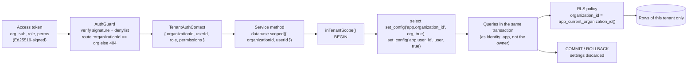

# Tenant isolation

Status: **Built** for identity-service (phase 2); ingest-service has the plumbing (phase 3) and its
tables arrive in phase 4. Every service reuses the same mechanism. Decisions: [ADR-0006](../adr/0006-multi-tenancy-shared-schema.md),
[ADR-0012](../adr/0012-postgresql-row-level-security.md). Related: [authorization](authorization.md).

## Strategy

Shared database, shared schema, `organization_id` on every tenant-owned row, with independent
layers so that one mistake is not a breach:

1. **Application.** The tenant comes only from the verified access token. Services read it from
   `TenantAuthContext`, never from the body, query string or path. A route's `:organizationId` is
   only compared with the token and answered with `404` on mismatch.
2. **Database.** Every unit of work runs in a transaction that carries the tenant in PostgreSQL
   settings, and Row Level Security policies filter every statement by it. A forgotten `WHERE`
   returns the caller's own rows, not everyone's.
3. **Schema.** From phase 3, composite foreign keys `(organization_id, id)` stop a row in one tenant
   from referencing a row in another even with a guessed UUID. identity-service has no
   cross-tenant references to protect yet (roles are global system rows).
4. **Tests.** Isolation is proven at the database level (as the real runtime role) and at the
   HTTP level (as real users), against real PostgreSQL and Redis.

## How tenant context reaches the database



Step by step:

1. `AuthGuard` verifies the token and builds `AuthContext` from its claims (`toAuthContext`). On
   routes with `@RequireOrganization` / `@RequirePermission` it requires an `org` claim and a
   matching `:organizationId`, so the handler receives a `TenantAuthContext` whose
   `organizationId` is non-null.
2. Services call `Database.scoped({ organizationId: auth.organizationId, userId: auth.userId }, work)`
   (`apps/identity-service/src/database/database.module.ts`). There is no other way to get a
   transaction: `Database.unscoped(work)` is the same helper with both values null.
3. `inTenantScope` (`packages/service-kit/src/database/tenant-scope.ts`) opens a transaction and,
   as its first statement, runs `set_config('app.organization_id', $1, true)` and
   `set_config('app.user_id', $2, true)`. The values are bound parameters, never interpolated.
   The third argument `true` makes the settings **transaction-local** (equivalent to `SET LOCAL`).
4. Policies read the settings through two SQL functions defined in
   `drizzle/0001_row_level_security.sql`:

   ```sql
   app_current_organization_id() = NULLIF(current_setting('app.organization_id', true), '')::uuid
   app_current_user_id()         = NULLIF(current_setting('app.user_id', true), '')::uuid
   ```

   `current_setting(..., true)` returns null instead of erroring when the setting is absent, and
   an empty string becomes null.

## Default deny

With no context, both functions return `NULL`, and `organization_id = NULL` is never true. A
query that runs outside `inTenantScope`, or inside `unscoped`, sees **zero** tenant rows and can
write none. Missing context fails closed by returning nothing, not by returning everything.
Test: "sees no tenant rows at all without a tenant context (default deny)".

## Tables with RLS and their policies

All policies are in `apps/identity-service/drizzle/0001_row_level_security.sql`. RLS is
`ENABLE`d, not `FORCE`d (see [migrations](#migrations)).

| Table                  | Command | Policy                        | Rule                                                                                                                                    |
| ---------------------- | ------- | ----------------------------- | --------------------------------------------------------------------------------------------------------------------------------------- |
| `organization_members` | SELECT  | `organization_members_select` | `organization_id = app_current_organization_id() OR user_id = app_current_user_id()`                                                    |
|                        | INSERT  | `organization_members_insert` | `WITH CHECK organization_id = app_current_organization_id()`                                                                            |
|                        | UPDATE  | `organization_members_update` | `USING` and `WITH CHECK organization_id = app_current_organization_id()`                                                                |
|                        | DELETE  | `organization_members_delete` | `organization_id = app_current_organization_id()`                                                                                       |
| `organizations`        | SELECT  | `organizations_select`        | `id = app_current_organization_id() OR EXISTS (member row with organization_id = organizations.id AND user_id = app_current_user_id())` |
|                        | INSERT  | `organizations_insert`        | `WITH CHECK id = app_current_organization_id()`                                                                                         |
|                        | UPDATE  | `organizations_update`        | `USING` and `WITH CHECK id = app_current_organization_id()`                                                                             |
|                        | DELETE  | `organizations_delete`        | `id = app_current_organization_id()`                                                                                                    |
| `invitations`          | ALL     | `invitations_tenant`          | `USING` and `WITH CHECK organization_id = app_current_organization_id()`                                                                |
| `permissions`          | SELECT  | `permissions_read`            | `true` (no write policy)                                                                                                                |
| `roles`                | SELECT  | `roles_read`                  | `organization_id IS NULL OR organization_id = app_current_organization_id()` (no write policy)                                          |
| `role_permissions`     | SELECT  | `role_permissions_read`       | `true` (no write policy)                                                                                                                |

Notes on specific rules:

- **Own memberships across tenants.** The user-id branch on `organization_members` (and the
  `EXISTS` on `organizations`) lets a user list and switch between their own organizations while
  the active organization is someone else, or none. It exposes only rows where `user_id` is the
  caller; other members of those organizations stay invisible. Writes have no user-id branch.
  Test: "lets a user see their own memberships across organizations, and nothing more".
- **`WITH CHECK` stops moving rows.** `UPDATE organization_members SET organization_id = <other>`
  fails the check. Test: "cannot move its own rows into another tenant".
- **Creating an organization.** `OrganizationsService.create` generates the new id first and runs
  the transaction with that id as the tenant context, so `organizations_insert` admits exactly
  that one row, and the creator's `OWNER` membership passes `organization_members_insert`.
- **The `EXISTS` subquery is itself filtered** by the `organization_members` policy of the calling
  role, which is what makes it return only the caller's memberships.

### The access catalog: read-only at runtime

`permissions`, `roles` and `role_permissions` have RLS enabled with **only** a `SELECT` policy.
For the runtime role an `INSERT`, `UPDATE` or `DELETE` matches no policy: inserts fail with
`42501` (insufficient privilege) and updates/deletes affect zero rows. The catalog can only be
changed by the owner role in `syncAccessCatalog` at deploy time. Test: "cannot tamper with the
access catalog". Organization-specific roles (not built yet) are readable only in their organization.

## Tables without RLS, on purpose

| Table            | Why not                                                                                                                                                     | What protects it instead                                                                                                                                                      |
| ---------------- | ----------------------------------------------------------------------------------------------------------------------------------------------------------- | ----------------------------------------------------------------------------------------------------------------------------------------------------------------------------- |
| `users`          | Not tenant-owned: one person belongs to many organizations, and login looks a user up by email before any organization is known.                            | Queried only by the token's `sub` or by exact email in login/registration/reset; exposed to other members only through a join from `organization_members`, which is filtered. |
| `sessions`       | User-scoped, not tenant-scoped; refresh runs with no access token at all, keyed only by the refresh token hash.                                             | Queried by token hash (256-bit secret) or by `user_id = auth.userId`; another user's session id is `404`.                                                                     |
| `refresh_tokens` | Same as sessions; the lookup key is the SHA-256 of the secret.                                                                                              | Unique hash lookup; possession of the secret is the authorization.                                                                                                            |
| `email_tokens`   | Password reset and email verification start from a link, with no session and no organization.                                                               | Unique hash lookup, purpose check, single use, expiry.                                                                                                                        |
| `outbox_events`  | Written in every context, including events with `organization_id IS NULL` (`user.registered`, `session.revoked`), and read by the relay across all tenants. | Insert-only from application code (`recordEvent`); no API reads it; the relay (phase 7) publishes the event's own `organizationId`.                                           |

These tables are accessed through `Database.unscoped`, which still runs through `inTenantScope`
with null context, so an accidental join from them into a tenant table returns no tenant rows.

## SECURITY DEFINER invitation lookup

Accepting an invitation starts from a token in an email link: the invitee has no membership yet
and their access token has no (or a different) organization, so `invitations_tenant` would hide
the row. Instead of weakening the policy, the migration adds one narrow function:

```sql
find_invitation_by_token_hash(p_token_hash text)
  RETURNS TABLE (id, organization_id, email, role_id, expires_at, accepted_at, revoked_at)
  LANGUAGE sql STABLE SECURITY DEFINER
  SET search_path = public, pg_temp
```

- It runs as the owner, so it can see the row, but it returns **at most one** invitation, the one
  whose `token_hash` equals the argument. Without the 256-bit secret there is nothing to find.
- `SET search_path = public, pg_temp` prevents search-path hijacking of a definer function.
- It only reads. `InvitationsService.accept` then checks expiry, revocation and that the signed-in
  user's email equals the invited email, and performs the actual write inside
  `scoped({ organizationId: invitation.organization_id, userId })`, re-reading the invitation
  `FOR UPDATE` under normal RLS. Two concurrent accepts serialise on that lock.

Test: "resolves an invitation by token hash without context, and only that invitation".

## Pooled connection safety

Connections are pooled (`pg.Pool`). Settings made with `set_config(name, value, true)` belong to
the current transaction and are discarded at `COMMIT` or `ROLLBACK`, including when the work
throws. The next transaction on the same physical connection starts with no tenant context, and
`inTenantScope` always sets both values at the start of every transaction (empty when null), so a
context can neither leak forward nor be inherited. Session-level `SET` is never used. Test: "does
not leak tenant context between transactions on a pooled connection". This remains correct behind
PgBouncer in transaction pooling mode, because the settings live exactly as long as the
transaction the pooler pins.

## Background jobs

There is no request and no access token, so the job must name the tenant explicitly:

- **Tenant work driven by events** (phase 7 onwards): the consumer takes the tenant from the
  event envelope's `organizationId`, which the producer wrote from its own verified context, and
  runs its side effect in `inTenantScope({ organizationId: event.organizationId, userId: event.actorId })`.
  One transaction per event (or per tenant batch), never one transaction spanning tenants. The
  `TenantScope` type documents this: "derived from the verified access token (or, for background
  work, from the event being processed), never from request input".
- **System jobs** that are inherently cross-tenant, such as the outbox relay, operate on tables
  without RLS (`outbox_events`) and do not touch tenant tables. A job that genuinely needs
  cross-tenant reads of tenant tables will get its own role and ADR; it will not reuse the
  runtime role or disable RLS.

## Migrations

Migrations run as `<service>_owner` via `MIGRATION_DATABASE_URL` (`src/database/migrate.ts`, a
one-off deployment step before the new version starts). The running service connects as
`<service>_app` via `DATABASE_URL`. `infra/docker/postgres/init/10-service-databases.sh` creates
both roles per service database, makes the owner own the schema, and grants the app role DML
on future tables through `ALTER DEFAULT PRIVILEGES`.

RLS is **enabled but not forced**. Table owners bypass non-forced RLS, which is what lets the
owner apply migrations, backfill data and run `syncAccessCatalog`. This departs from the
`FORCE ROW LEVEL SECURITY` sketched in ADR-0006; ADR-0012 records why. The safety of this choice
rests on the runtime role never being the owner, which the readiness guard enforces.

## Administrative operations

Support or operator access to a tenant's data is **not built**. The design: a separate,
privileged path that requires an explicit target tenant, runs through the same `inTenantScope`
and RLS path with that tenant, and writes every access to the audit log (audit-service, phase 10).
There is no "view all tenants" query in the application, and the owner role is not available to
the running service.

## The readiness guard

RLS silently does nothing for superusers, roles with `BYPASSRLS`, and (without `FORCE`) table
owners. A wrong `DATABASE_URL`, for example the owner URL pasted into the runtime slot, would
turn isolation off with no error. `assertRowLevelSecurityEnforced`
(`packages/service-kit/src/database/rls-enforcement.ts`) inspects `pg_roles` for `current_user`
and fails if the role is a superuser, has `BYPASSRLS`, or owns any table with row security
enabled. `Database.onModuleInit` registers it as the `row-level-security` readiness check, so
`GET /health/ready` answers `503` and the load balancer never routes traffic to a misconfigured
instance. Test: "runs as a role that cannot bypass RLS, while the owner role is detected as unsafe",
and `test/app.test.ts` asserts the check is registered.

## 404, not 403

Anything in another tenant is reported as `404 NOT_FOUND`, identical to an id that does not
exist, so the API cannot be used to confirm that an organization, member, invitation or session
exists:

- the guard answers `404` when a route's `:organizationId` differs from the token's organization;
- services look targets up inside the tenant scope, so a foreign id simply finds nothing;
- `switch-organization` to an organization without an active membership is `404`.

`403` means "this exists in your organization, but you lack the permission or break a
management rule". Test: "gets the same 404 for a real B id as for a random one (no enumeration oracle)".

## How the tests prove isolation

All suites run against real PostgreSQL and Redis (`apps/identity-service/test/support/global-setup.ts`),
with the service connected as the runtime role exactly as in production.

**Database level: `rls.integration.test.ts` (12 tests).** Seeds two organizations as the owner
role, then queries as `identity_app` with raw SQL, bypassing all application code:

- runtime role passes the readiness check; owner role is detected as unsafe;
- default deny without context;
- cannot read another tenant even when selecting its ids explicitly;
- a query without `WHERE` returns only the own tenant;
- `UPDATE`/`DELETE` on another tenant's rows change 0 rows;
- `INSERT` into another tenant is rejected by `WITH CHECK`;
- rows cannot be moved into another tenant;
- legitimate work in the own tenant still succeeds;
- own memberships are visible across organizations, and nothing more;
- no context leak between transactions on a pooled connection;
- the access catalog cannot be modified;
- the SECURITY DEFINER lookup finds exactly the invitation matching the hash.

**HTTP level: `tenant-isolation.integration.test.ts` (14 tests).** Alice owns organization A, Bob
owns B, a third user belongs to both. Through the real HTTP stack, Alice cannot read, modify,
delete in or create data inside B; cannot reach B's rows by putting B's ids under A's own routes
(IDOR); gets the same `404` for a real B id as for a random one; cannot switch into B; cannot
smuggle a tenant id through the request body; cannot redeem an invitation addressed to someone in
B; only lists her own organizations; and a token whose `org` claim was rewritten to B is rejected.
Legitimate work in A still succeeds, Bob is equally isolated from A, and the user in both
organizations acts only in the organization of the current token, with switching verified
server-side.

**Authorization: `authorization.integration.test.ts` (13 tests)** covers roles, ranks and immediate
revocation inside one tenant; see [authorization](authorization.md).

## ingest-service

The same three layers, applied to every webhook resource table (Phase 4):

- **Context.** `Database.forTenant(scope, work)` is the only entry point to the ingest database; it
  wraps `inTenantScope`. There is no unscoped variant for tenant data. The `row-level-security`
  readiness check guards the runtime role (`ingest_app`) exactly as in identity.
- **Tables.** `applications`, `event_types`, `endpoints`, `endpoint_event_types`, `endpoint_secrets`,
  `api_keys`, `messages`, `idempotency_keys` and `deliveries` each have RLS enabled with one `FOR ALL` policy comparing `organization_id` to
  `app_current_organization_id()` (`drizzle/0003_tenant_security.sql`, `0005_messages_security.sql`). `outbox_events` and
  `processed_events` have no RLS: they hold ids and event types only; consumers set the tenant from
  the event they process. The outbox relay reads `outbox_events` across tenants, and rows are
  written only inside tenant transactions.
- **Composite foreign keys.** Every reference is `(organization_id, <ref>_id) → (organization_id, id)`:
  endpoint → application, subscription → endpoint and event type, secret → endpoint, API key →
  application, message → application and event type, delivery → message and endpoint. A row can only point at a row of its own organization, even for the owner role.
- **Tenant-less reads.** API key authentication cannot know the tenant yet, so it calls the
  `SECURITY DEFINER` function `authenticate_api_key(digest)` (ADR-0027). The function has a fixed
  `search_path`, answers only for an active key of a live application, and is executable only by the
  runtime role. The `api_keys` table itself stays invisible without a tenant. The maintenance job
  removes expired idempotency records the same way, through `purge_expired_idempotency_keys()`.
- **Tests.** `test/rls.integration.test.ts` proves, per table and against PostgreSQL as the runtime
  role, that no context means no rows, a tenant sees only its rows, cross-tenant writes fail, and
  composite keys refuse cross-tenant references. `test/tenant-isolation.integration.test.ts` proves
  over HTTP that organization B cannot read, change, archive, reveal, subscribe to or revoke any of
  organization A's resources (`404`). `test/api-key-authentication.integration.test.ts` covers the
  definer function.

## Known limitations

- `organizations_select` uses an `EXISTS` over `organization_members` per row. Cheap at identity's
  scale (index `organization_members_user_id_idx`), but it is the kind of policy to check with
  `EXPLAIN` if it moves to a hot path.
- `users` has no RLS. Any future endpoint that searches users must go through
  `organization_members` in a tenant scope.
- When organization-specific roles are added, `organization_members.role_id` and
  `invitations.role_id` need a check (or composite key) that the role is global or belongs to the
  same organization; today only system roles exist.
